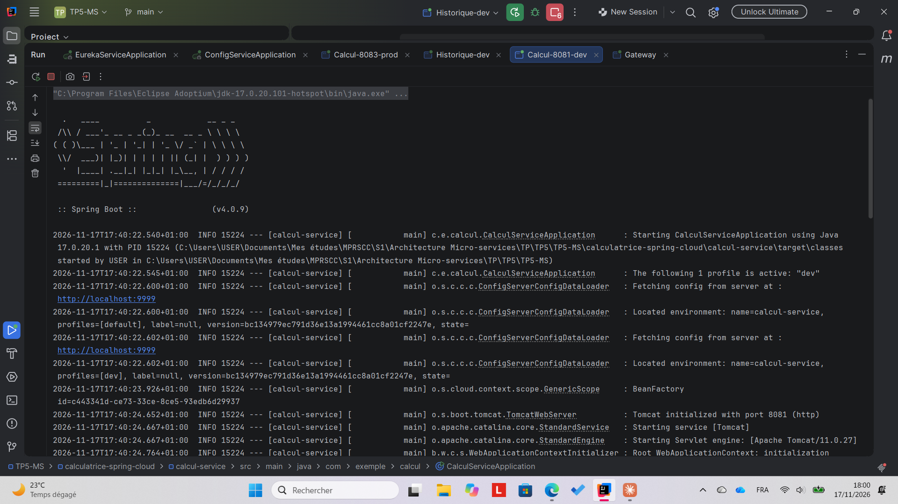
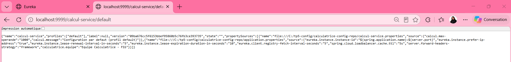

# Architecture Microservices

Dépôt centralisé regroupant l'ensemble des travaux pratiques de la matière **Architecture Microservices**. Chaque TP est un projet autonome, dans son propre dossier, accompagné de son README détaillé.

> Les TP1 à TP5 existent aussi dans leurs dépôts d'origine (liens dans l'index), qui restent inchangés. Les TP suivants sont publiés uniquement ici.

## Index des TP

<!-- TP-INDEX:START -->
| TP | Thème | Technologies | Dépôt d'origine |
|----|-------|--------------|-----------------|
| [TP1-MS](./TP1-MS) | Inversion de Contrôle et Injection de Dépendances | Java, Maven, Spring | [Amalkaraoud/TP1-MS](https://github.com/Amalkaraoud/TP1-MS) |
| [TP2-MS](./TP2-MS) | REST : service web « Calculatrice » avec JAX-RS et Tomcat | Java, JAX-RS, Tomcat | [Amalkaraoud/TP2-MS](https://github.com/Amalkaraoud/TP2-MS) |
| [TP3-MS](./TP3-MS) | REST : microservice « Calculatrice » avec Spring Boot | Java, Spring Boot | [Amalkaraoud/TP3-MS](https://github.com/Amalkaraoud/TP3-MS) |
| [TP4-MS](./TP4-MS) | Spring Cloud : « Calculatrice » avec Eureka, Gateway et OpenFeign | Java, Spring Cloud, Eureka, Gateway, OpenFeign | [Amalkaraoud/TP4-MS](https://github.com/Amalkaraoud/TP4-MS) |
| [TP5-MS](./TP5-MS) | Spring Cloud Config : configuration centralisée de la « Calculatrice » | Java, Spring Boot, Spring Cloud Config, Eureka, Gateway, Git | [Amalkaraoud/TP5-MS](https://github.com/Amalkaraoud/TP5-MS) |
<!-- TP-INDEX:END -->

Cliquer sur le nom d'un TP pour accéder à son dossier et à son README.

## À la une : TP5 — Spring Cloud Config

> **Dossier : [`TP5-MS/`](./TP5-MS)** · **README détaillé : [`TP5-MS/README.md`](./TP5-MS/README.md)** · Dépôt d'origine : [Amalkaraoud/TP5-MS](https://github.com/Amalkaraoud/TP5-MS)

Le TP5 prolonge la « Calculatrice » du TP4 (Eureka, Spring Cloud Gateway, `calcul-service`, `historique-service`) en y ajoutant une **configuration centralisée**. Jusqu'au TP4, chaque microservice portait ses réglages dans son propre `application.properties` : modifier une limite imposait de toucher au code, de reconstruire et de redémarrer chaque instance. Désormais, un serveur de configuration lit ses fichiers dans un dépôt Git et les distribue aux microservices selon leur nom et leur profil.

### Objectifs

- Créer un serveur **Spring Cloud Config** (`config-service`, port 9999) adossé à un dépôt Git local, `calculatrice-config-repo`.
- Transformer `calcul-service` et `historique-service` en **clients de configuration** (`spring.config.import`).
- Observer l'ordre de priorité des sources : fichier par service et par profil, puis fichier par service, puis fichier commun.
- Faire coexister deux instances du même service en profils **`dev`** et **`prod`** derrière la passerelle.
- Recharger la configuration **à chaud**, sans redémarrage, par `POST /actuator/refresh` (`@RefreshScope`, `@ConfigurationProperties`).
- Tracer chaque modification avec Git et comprendre le rôle du champ `version`.

### Technologies

| Outil | Rôle |
|---|---|
| Java 17, Maven (multi-module) | langage et construction |
| Spring Boot 4.0.9 | socle des cinq modules |
| Spring Cloud 2025.1.x | Config Server et Client, Netflix Eureka, Gateway, OpenFeign |
| Spring Boot Actuator | points `health`, `env` et `refresh` |
| Git | dépôt de configuration et historique des changements |

### Architecture

| Module | Port | Rôle |
|---|---|---|
| `eureka-service` | 8761 | annuaire des services (inchangé) |
| `config-service` | 9999 | serveur de configuration (**nouveau**) |
| `calcul-service` | 8081 et 8083 | opérations arithmétiques, client de configuration |
| `historique-service` | 8082 | historique des opérations, client de configuration |
| `gateway-service` | 8888 | passerelle (inchangée) |

### Structure du dossier `TP5-MS/`

    TP5-MS/
    ├── README.md                       compte rendu détaillé du TP5
    ├── pom.xml                         POM parent (5 modules)
    ├── calculatrice-config-repo.zip    dépôt de configuration avec son .git (3 commits)
    ├── screenshots/                    15 captures d'écran réelles
    ├── eureka-service/
    ├── config-service/
    ├── calcul-service/
    ├── historique-service/
    └── gateway-service/

### Accéder au projet et l'exécuter

Prérequis : JDK 17, Maven, Git, et les ports 8761, 9999, 8081, 8083, 8082 et 8888 libres.

    git clone https://github.com/Amalkaraoud/Architecture-Microservices.git
    cd Architecture-Microservices/TP5-MS

    # 1. Construire les cinq modules
    mvn clean package -DskipTests

    # 2. Reconstituer le dépôt de configuration (le zip contient son dossier .git)
    unzip calculatrice-config-repo.zip -d <dossier-de-travail>

Le serveur lit le dépôt de configuration à l'adresse définie par `spring.cloud.config.server.git.uri` dans [`config-service/src/main/resources/application.properties`](./TP5-MS/config-service/src/main/resources/application.properties). La valeur par défaut est `file:///C:/tp5-config/calculatrice-config-repo` (TP d'origine, sous Windows) ; elle peut être remplacée sans modifier le code par la variable d'environnement `CONFIG_REPO_URI` :

    export CONFIG_REPO_URI=file:///chemin/absolu/vers/calculatrice-config-repo

Démarrer ensuite les services **dans cet ordre**, chacun depuis son module :

    # Eureka (8761), puis le serveur de configuration (9999)
    mvn -pl eureka-service spring-boot:run
    mvn -pl config-service spring-boot:run

    # Deux instances de calcul-service avec des profils différents
    mvn -pl calcul-service spring-boot:run -Dspring-boot.run.arguments="--spring.profiles.active=dev"
    mvn -pl calcul-service spring-boot:run -Dspring-boot.run.arguments="--server.port=8083 --spring.profiles.active=prod"

    # historique-service (8082), puis la passerelle (8888)
    mvn -pl historique-service spring-boot:run -Dspring-boot.run.arguments="--spring.profiles.active=dev"
    mvn -pl gateway-service spring-boot:run

Vérifications utiles :

    curl http://localhost:9999/calcul-service/default       # configuration servie, avec le champ "version"
    curl http://localhost:8081/calcul/config                # configuration effective de l'instance 8081
    curl -X POST http://localhost:8081/actuator/refresh     # rechargement à chaud

### Liens directs

- [README détaillé du TP5](./TP5-MS/README.md) : déroulement, résultats des tests et réponses aux questions
- [POM parent](./TP5-MS/pom.xml)
- [Serveur de configuration](./TP5-MS/config-service/src/main/java/com/exemple/config/ConfigServiceApplication.java)
- [Dépôt de configuration (archive avec historique Git)](./TP5-MS/calculatrice-config-repo.zip)
- [Captures d'écran](./TP5-MS/screenshots)

### Aperçu des résultats

| Console de `calcul-service` (8081, profil `dev`) | Historique du dépôt de configuration |
|---|---|
|  |  |

*Le serveur de configuration (port 9999) renvoie les sources de `calcul-service` par ordre de priorité, avec le champ `version` du dernier commit.*

*`historique-service` interroge le serveur de configuration au démarrage (`Located environment`).*

Les quinze captures sont commentées dans la [section 10 du README du TP5](./TP5-MS/README.md#10-captures-décran).

## Structure du dépôt

<!-- TP-TREE:START -->
    Architecture-Microservices/
    ├── README.md
    ├── TP1-MS/
    ├── TP2-MS/
    ├── TP3-MS/
    ├── TP4-MS/
    ├── TP5-MS/
    ├── docs/
    ├── scripts/
    └── templates/
<!-- TP-TREE:END -->

Chaque dossier `TP<N>-MS` est autonome : il se compile et s'exécute indépendamment des autres.

## Ajouter un nouveau TP

    powershell -ExecutionPolicy Bypass -File .\scripts\new-tp.ps1 -Numero 5 -Titre "Titre du TP" -Tech "Java, Spring Boot"

Le script crée le dossier et son README (depuis `templates/TP-README.md`), puis met à jour l'index ci-dessus. Détails : [docs/CONVENTIONS.md](./docs/CONVENTIONS.md).

## Utilisation

    git clone https://github.com/Amalkaraoud/Architecture-Microservices.git
    cd Architecture-Microservices/TP1-MS

Les instructions de compilation et d'exécution se trouvent dans le README de chaque TP.

## Auteur

Amal Karaoud — [github.com/Amalkaraoud](https://github.com/Amalkaraoud)