# TP5 — Configuration centralisée de la « Calculatrice » avec Spring Cloud Config

| | |
|---|---|
| **Établissement** | Faculté des Sciences de Sfax — Département d'informatique et des Communications |
| **Matière** | Architecture MicroServices — filière MPSRCC1 |
| **Enseignantes** | Corinne Amel ZAYANI, Amal ABID |
| **Année universitaire** | 2026-2027 |
| **Base** | Projet du TP4 (`calculatrice-spring-cloud`), étendu sans régression |

## 1. Présentation

Ce travail prolonge l'application « Calculatrice » du TP4 (annuaire Eureka, passerelle Spring Cloud Gateway, deux microservices `calcul-service` et `historique-service`). Jusqu'ici, chaque microservice portait sa configuration dans son propre `application.properties` : changer une limite ou un réglage Eureka imposait de modifier le code, de reconstruire puis de redémarrer chaque instance.

Le TP5 introduit un **serveur de configuration** (`config-service`, port 9999) qui lit ses fichiers dans un dépôt Git. Les microservices deviennent des **clients de configuration** : ils récupèrent leurs propriétés au démarrage selon leur nom et leur profil (`dev`, `prod`), et peuvent les relire à chaud par `POST /actuator/refresh`.

## 2. Objectifs

- Créer un serveur Spring Cloud Config adossé à un dépôt Git local (`calculatrice-config-repo`).
- Transformer `calcul-service` et `historique-service` en clients de configuration (`spring.config.import`).
- Observer l'ordre de priorité des sources (fichier par service, par profil, fichier commun).
- Exploiter les profils `dev` et `prod` pour deux instances du même service derrière la passerelle.
- Recharger la configuration sans redémarrage (`/actuator/refresh`, `@RefreshScope`, `@ConfigurationProperties`).
- Tracer les changements de configuration avec Git (trois commits) et comprendre le rôle du champ `version`.

## 3. Technologies et outils

| Outil | Version / rôle |
|---|---|
| Java | 17 (Eclipse Temurin 17.0.20) |
| Spring Boot | 4.0.9 |
| Spring Cloud | 2025.1.x : Config Server et Client, Netflix Eureka, Gateway, OpenFeign |
| Maven | multi-module (projet parent `calculatrice-spring-cloud`) |
| springdoc-openapi | Swagger UI de chaque microservice |
| Spring Boot Actuator | points `health`, `env`, `refresh` |
| Git | dépôt de configuration, historique des modifications |
| IntelliJ IDEA | exécution et consoles des cinq services |

## 4. Prérequis

- JDK 17 installé et sélectionné comme SDK du projet (voir la capture 1).
- Maven (intégré à IntelliJ) ou `mvn` en ligne de commande.
- Git.
- Ports libres : 8761, 9999, 8081, 8083, 8082, 8888.

## 5. Structure du projet

```
calculatrice-spring-cloud/
├── pom.xml                         POM parent (5 modules)
├── README.md
├── calculatrice-config-repo.zip    dépôt de configuration avec son dossier .git (3 commits)
├── screenshots/                    captures d'écran réelles
├── eureka-service/                 annuaire (8761)                       — inchangé
├── config-service/                 serveur de configuration (9999)       — nouveau
├── calcul-service/                 opérations arithmétiques (8081, 8083) — client de configuration
├── historique-service/             historique des opérations (8082)      — client de configuration
└── gateway-service/                passerelle (8888)                     — inchangée
```

Contenu du dépôt de configuration (`calculatrice-config-repo`) :

```
application.properties              réglages communs (Eureka, Actuator, équipe)
calcul-service.properties           défauts de calcul-service (max-operande=2000 après E.1)
calcul-service-dev.properties       profil dev  (max-operande=100)
calcul-service-prod.properties      profil prod (max-operande=1000000)
historique-service.properties       défauts d'historique-service (max-operations=2 après E.3)
historique-service-dev.properties   profil dev  (max-operations=3)
historique-service-prod.properties  profil prod (max-operations=1000)
```

## 6. Déroulement détaillé

### Étape 1 — Vérification de l'environnement et de la compilation

Le SDK du projet est Temurin 17 (capture 1). Dans le panneau Maven, `clean` puis `package` (tests ignorés) construisent les cinq modules : `BUILD SUCCESS` (captures 2 et 3). En ligne de commande :

```bash
mvn clean package -DskipTests
```

### Étape 2 — Dépôt de configuration (parties A et B)

Un dépôt Git distinct du projet contient les sept fichiers listés plus haut. Le premier commit crée l'ensemble :

```bash
cd C:\tp5-config\calculatrice-config-repo
git init
git add .
git commit -m "Configuration initiale de la calculatrice"
```

Les propriétés communes de `application.properties` utilisent des `${…}` (`eureka.instance.instance-id=${spring.application.name}:${server.port}`) : chaque client les résout avec ses propres valeurs (réponse B.1).

### Étape 3 — Serveur de configuration (partie C)

Nouveau module `config-service` : dépendances `spring-cloud-config-server` et `eureka-client`, annotation `@EnableConfigServer` sur la classe principale, puis dans `application.properties` :

```properties
spring.application.name=config-service
server.port=9999
spring.cloud.config.server.git.uri=file:///C:/tp5-config/calculatrice-config-repo
spring.cloud.config.server.git.default-label=main
```

Vérification : `http://localhost:9999/calcul-service/default` renvoie les sources par ordre de priorité et le champ `version` (huit requêtes C.5, captures 8 à 15).

### Étape 4 — Clients de configuration (partie D)

`calcul-service` et `historique-service` reçoivent les dépendances `spring-cloud-starter-config` et `spring-boot-starter-actuator`. Leur `application.properties` local ne garde que ce qui doit être connu avant d'interroger le serveur :

```properties
spring.application.name=calcul-service
server.port=8081
spring.config.import=optional:configserver:http://localhost:9999
management.endpoints.web.exposure.include=health,env,refresh
management.endpoint.env.show-values=always
```

Côté code : `ConfigController` (`GET /calcul/config`) et la limite `calcul.max-operande` dans `CalculController` pour `calcul-service` ; `HistoriqueParams` (`@ConfigurationProperties`), `HistoriqueConfigController` (`GET /operations/config`) et la limite `historique.max-operations` (réponse 409) pour `historique-service`.

Lancement dans l'ordre : Eureka (8761) → config-service (9999) → `calcul-service` 8081 → `calcul-service` 8083 (`--server.port=8083`) → `historique-service` (8082) → passerelle (8888). Chaque console client journalise `Located environment` (voir §8).

### Étape 5 — Modification à chaud (partie E)

1. E.1 : `calcul.max-operande` passe de 1000 à 2000 dans `calcul-service.properties`, commit « Limite de calcul-service relevee a 2000 ». Avant le refresh les deux instances répondent 1000 ; après `POST http://localhost:8081/actuator/refresh` (réponse `["calcul.max-operande"]`), l'instance 8081 répond 2000.
2. E.3 : `historique.max-operations` passe à 2 et le nom d'équipe est modifié, commit « Limite d'historique-service abaissee a 2, nom d'equipe modifie ».

```bash
curl -X POST http://localhost:8081/actuator/refresh
curl -X POST http://localhost:8082/actuator/refresh
```

### Étape 6 — Profils dev et prod (partie F)

Deux instances du même service avec des profils différents, derrière la passerelle :

```text
calcul-service  (8081) : --spring.profiles.active=dev
calcul-service  (8083) : --server.port=8083 --spring.profiles.active=prod
historique-service     : --spring.profiles.active=dev
```

La passerelle alterne entre les deux instances : limite de 100 (dev) ou de 1 000 000 (prod) pour une même URL.

### Étape 7 — Livraison

```bash
git add -A
git commit -m "TP5 : Spring Cloud Config (config-service, profils dev/prod, refresh)"
git push -u origin main
```

## 7. Configurations importantes

| Fichier | Propriété | Rôle |
|---|---|---|
| `config-service/application.properties` | `spring.cloud.config.server.git.uri` | dépôt lu par le serveur (`file:///` : arbre de travail) |
| `calcul-service/application.properties` | `spring.config.import=optional:configserver:http://localhost:9999` | adresse du serveur, connue avant Eureka |
| `calcul-service` et `historique-service` | `management.endpoints.web.exposure.include=health,env,refresh` | expose `/actuator/refresh` |
| `calcul-service` et `historique-service` | `eureka.client.refresh.enable=false` | évite la désinscription d'Eureka lors d'un refresh (voir §10) |
| dépôt de configuration | `calcul.max-operande`, `historique.max-operations` | limites modifiables à chaud |

## 8. Exécution : installation et lancement

1. Décompresser `calculatrice-config-repo.zip` dans `C:\tp5-config\` (le dossier `.git` est inclus).
2. Ouvrir le projet dans IntelliJ, vérifier le SDK 17, puis `mvn clean package -DskipTests`.
3. Démarrer les six processus dans l'ordre de l'étape 4 (configurations d'exécution IntelliJ ou `java -jar …`, voir réponse 11 de synthèse).
4. Tester : Swagger UI de chaque service, `http://localhost:8761` (annuaire), `http://localhost:8888/calcul-service/calcul/config` (passerelle).

Dans les consoles, chaque client interroge le serveur de configuration (`Fetching config from server at : http://localhost:9999`) puis journalise l'environnement reçu, par exemple pour l'instance 8081 en profil dev : `Located environment: name=calcul-service, profiles=[dev], label=null, version=bc134979ec791d36e13a1994461cc8a01cf2247e`. Un premier appel avec `profiles=[default]` précède celui du profil `dev`.

## 9. Tests et résultats

Tous les résultats ci-dessous ont été relevés lors d'exécutions réelles (consoles IntelliJ : Eureka 8761, config-service 9999, calcul-service 8081 et 8083, historique-service 8082, passerelle 8888).

| Partie | Test | Résultat observé |
|---|---|---|
| C.5 | `GET :9999/calcul-service/default` (huit requêtes) | sources par ordre de priorité, `version` 09ba676…, `calcul.max-operande` = 1000 |
| D.4 | `GET :8083/calcul/config` | identique à 8081, seul le port diffère (8083) |
| D.5 | `GET :8082/operations/config`, puis `POST /operations` | config par défaut (max 50) ; somme 8+2 → 201 ; produit 5000×2 → 400 « operande hors limite (max 1000) » ; division 7/0 → 400 |
| D.6 | passerelle `…/calcul-service/calcul/config` ×2 | alternance port 8083 puis 8081 ; `…/historique-service/operations/config` → 8082 ; `…/config-service/calcul-service/default` → 200 |
| E.1 | `max-operande` 1000 → 2000, `POST :8081/actuator/refresh` | avant : 1000 sur 8081 et 8083 ; réponse `["calcul.max-operande"]` ; après : 2000 sur 8081, `produit?a=1500&b=1` → 200 |
| E.3 (sans commit) | modification de `calcul.message` non commitée | le serveur la sert immédiatement, `version` reste 09ba676 (lecture de l'arbre de travail) ; le refresh liste seulement `calcul.message` |
| E.3 (après commits) | `POST :8082/actuator/refresh` | `["config.client.version","historique.max-operations","historique.message","calculatrice.equipe"]` ; `maxOperations` = 2 ; équipe inchangée (`@Value` sans `@RefreshScope`) |
| E.3 (séquence) | POST 8+2, POST 1+1, POST 2+2, DELETE /1, POST 2+2 | 201, 201, 409 « Historique plein : 2 operations au maximum », 204, 201 ; GET → [id 2, id 3] |
| F.1 / F.2 | passerelle `…/calcul/config` ×6 | alternance 8081 dev (max 100) / 8083 prod (max 1 000 000) |
| F.2 | passerelle `…/calcul/somme?a=500&b=1` ×6 | alternance 400 « operande hors limite (max 100) » / 200 « 501 » |
| F.3 | `historique-service` en dev | `maxOperations` 3 ; trois POST → 201 (ids 1 à 3) ; le suivant → 409 « Historique plein : 3 operations au maximum » ; `:9999/historique-service/dev` : dev=3, défaut=2, version bc134979… |

Réponse de `GET :8082/operations/config` en profil dev (F.3) : `{"service":"historique-service","port":8082,"profil":"dev","maxOperations":3,"message":"Profil dev : 3 operations au maximum","equipe":"Equipe Calculatrice - FSS (modification E.3)"}`.

Journal Git du dépôt de configuration (`git log --oneline`, commits B.2, E.1 et E.3) :

```
bc13497 Limite d'historique-service abaissee a 2, nom d'equipe modifie
aa372a0 Limite de calcul-service relevee a 2000
09ba676 Configuration initiale de la calculatrice
```

## 10. Difficultés rencontrées et solutions

| Difficulté | Cause | Solution |
|---|---|---|
| Après un `POST /actuator/refresh`, `calcul-service` disparaît d'Eureka ; la passerelle et OpenFeign répondent 503 « calcul-service injoignable » | le client Eureka est un bean `@RefreshScope` : le refresh le détruit et le désinscrit, puis le réenregistrement échoue (HTTP 400 au renouvellement du bail) | `eureka.client.refresh.enable=false` dans `calcul-service` et `historique-service` ; après correctif, un refresh répond `200 []` et les cinq instances restent `UP` |
| `500` sur `/calcul-service/default` au premier essai | dépôt de configuration non initialisé ou mal placé (message « No directory at file:/… ») | dépôt créé et validé dans `C:\tp5-config`, puis redémarrage du serveur |
| « Project JDK is not specified » au lancement Maven | SDK du projet vide | SDK 17 Temurin sélectionné (capture 1) |
| Nouvelle valeur visible sur le serveur mais version inchangée | pour un dépôt `file:///`, le serveur lit l'arbre de travail, pas les commits | comportement documenté dans la réponse E.3 ; les commits servent à la traçabilité |

## 11. Captures d'écran


### Configuration et construction

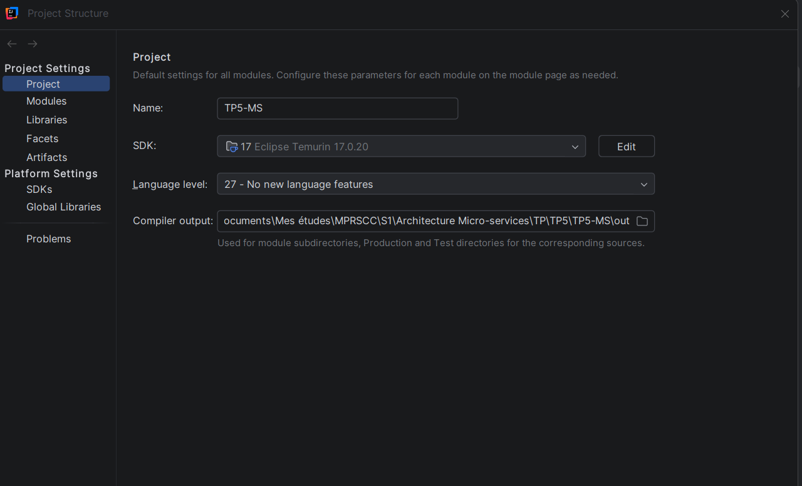

*Capture 1 — Project Structure d'IntelliJ : SDK Eclipse Temurin 17.0.20.*

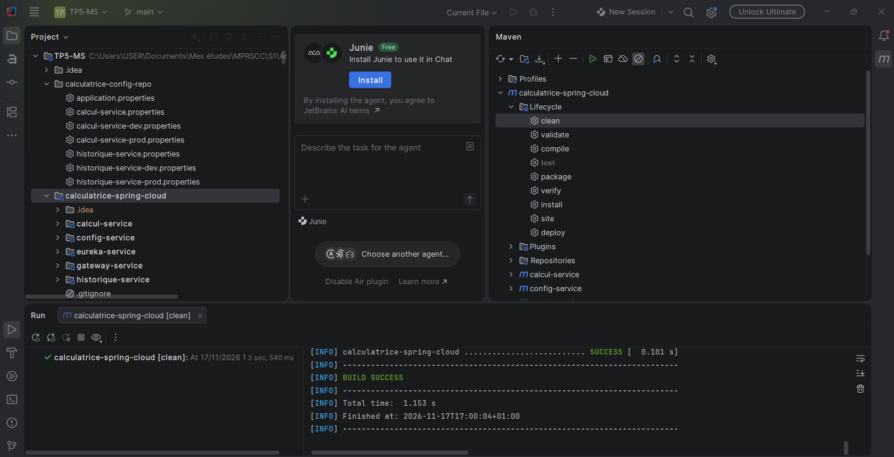

*Capture 2 — `mvn clean` sur le projet parent : BUILD SUCCESS.*

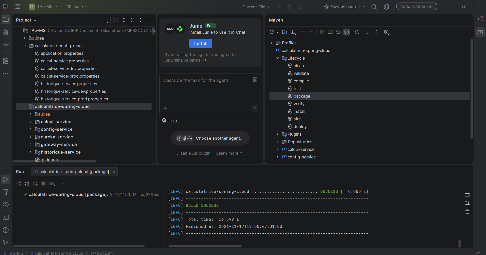

*Capture 3 — `mvn package` (tests ignorés) : les cinq modules sont construits, BUILD SUCCESS.*

### Lancement des services

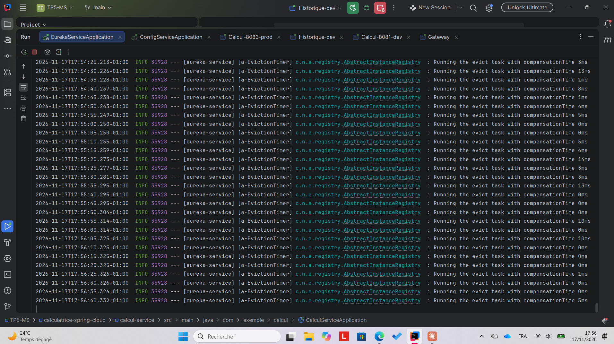

*Capture 4 — Console d'`eureka-service` (port 8761) en fonctionnement.*

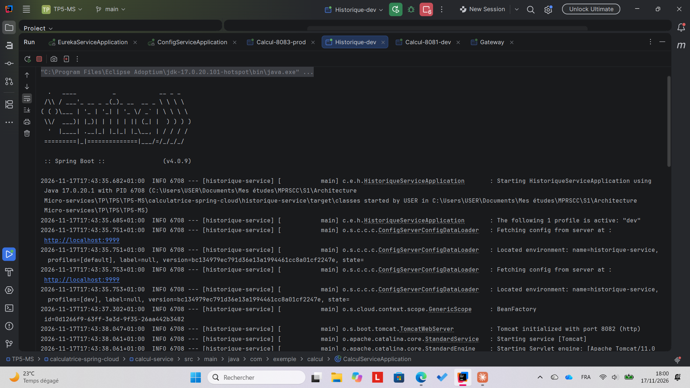

*Capture 5 — Console d'`historique-service` (8082, profil dev) : profil `dev` actif, `Fetching config from server at : http://localhost:9999`, deux lignes `Located environment` (`profiles=[default]` puis `profiles=[dev]`, version bc13497…).*


*Capture 6 — Console de `calcul-service` (8081, profil dev) : mêmes lignes `Located environment` pour `name=calcul-service`.*

### Dépôt de configuration

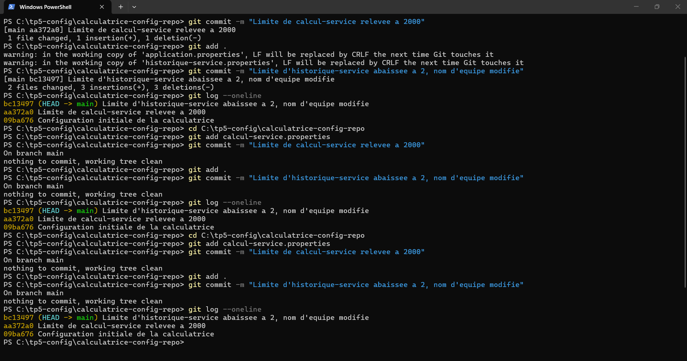

*Capture 7 — PowerShell dans `C:\tp5-config\calculatrice-config-repo` : les trois commits (09ba676, aa372a0, bc13497).*

### Test C.5 — huit requêtes sur le serveur de configuration


*Capture 8 — `GET /calcul-service/default` : sources `calcul-service.properties` puis `application.properties`, `calcul.max-operande` = 1000, version 09ba676….*

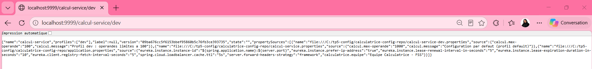

*Capture 9 — Requête C.5 n° 2.*

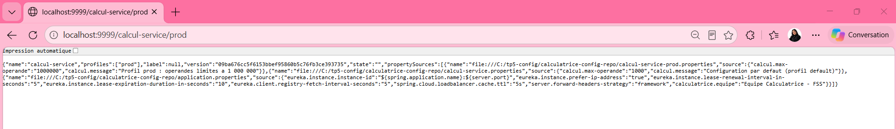

*Capture 10 — Requête C.5 n° 3.*

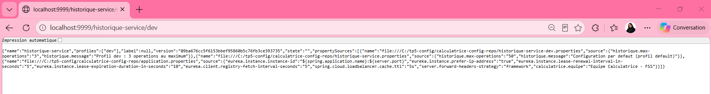

*Capture 11 — Requête C.5 n° 4.*

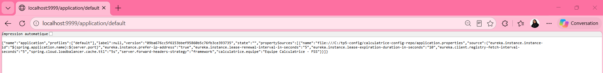

*Capture 12 — Requête C.5 n° 5.*

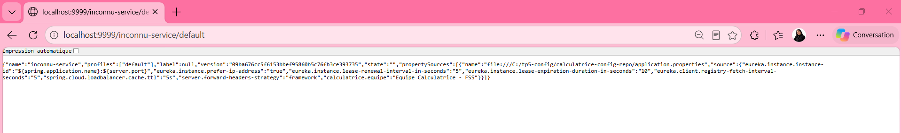

*Capture 13 — Requête C.5 n° 6.*

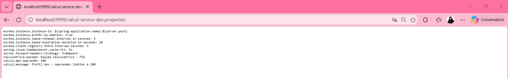

*Capture 14 — Requête C.5 n° 7.*

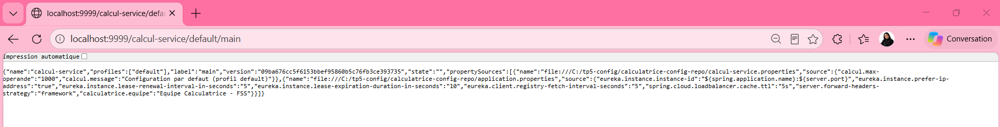

*Capture 15 — `GET /calcul-service/default/main` : l'étiquette `main` est reconnue (`label":"main"`).*


## 12. Conclusion

Le TP5 est réalisé : le serveur `config-service` centralise la configuration de la calculatrice dans un dépôt Git, les deux microservices en sont clients, deux instances d'un même service se distinguent par leur profil derrière la passerelle, et les modifications sont rechargées à chaud par `/actuator/refresh`, avec une trace Git de chaque changement. L'expérience a aussi montré deux points d'attention : le serveur d'un dépôt `file:///` lit l'arbre de travail et non les commits, et le client Eureka, étant `@RefreshScope`, doit être protégé du refresh par `eureka.client.refresh.enable=false`. Pour aller plus loin : sécuriser le serveur (Spring Security, valeurs `{cipher}`) et diffuser le rechargement à toutes les instances avec Spring Cloud Bus.

## 13. Réponses aux questions du TP

### Partie A

**A.4-1.** `spring.config.import` doit être connue avant que le microservice ne démarre : la configuration est lue pendant la préparation de l'environnement, avant la création des beans, donc avant que le client Eureka existe. L'annuaire ne peut donc pas fournir cette adresse. De plus, les réglages Eureka eux-mêmes viennent du serveur de configuration : le serveur doit être joignable par une adresse connue d'avance.

**A.4-2.** Les calculs continuent : chaque microservice a lu sa configuration au démarrage et la garde en mémoire. En revanche, relancer `calcul-service` pendant la panne pose problème : avec `optional:` le démarrage continue sans le serveur, mais `@Value("${calcul.max-operande}")` n'a alors aucune valeur ni valeur par défaut et le démarrage échoue (`Could not resolve placeholder`). Vérification expérimentale : question D.2.

**A.4-3.** L'instance 8081 renvoie la nouvelle valeur, l'instance 8083 renvoie encore l'ancienne. Comme la passerelle répartit les requêtes entre les deux, un client obtient des réponses différentes pour la même requête : les instances d'un même service sont incohérentes entre elles.

### Partie B

**B.1.** L'instance 8081 déclare `calcul-service:8081`, l'instance 8083 déclare `calcul-service:8083`. Le serveur ne remplace pas les `${…}` : chaque microservice les résout lui-même avec ses propres valeurs, `spring.application.name` venant de son `application.properties` local et `server.port` du fichier local (8081) ou de la ligne de commande (`--server.port=8083`).

### Partie C

**C.1.** Le client retient 100, valeur de `calcul-service-dev.properties`, première source de la liste. C'est la règle de priorité 2 du tableau A.2 (dépôt, service + profil) qui l'emporte sur la règle 3 (dépôt, service seul).

**C.2.** Avantage : un service sans fichier dédié démarre quand même avec les propriétés communes, sans erreur. Inconvénient : une faute dans `spring.application.name` n'est signalée par aucune erreur du serveur. Le microservice ne reçoit que les propriétés communes, et l'erreur n'apparaît que plus tard (propriété introuvable, ou valeur par défaut utilisée sans que personne ne le remarque).

### Partie D

**D.1.** Pour `server.port`, `/actuator/env` indiquerait le fichier local `application.properties` du module (8081), ou la ligne de commande pour l'instance 8083. Pour `spring.application.name`, la source est aussi le fichier local : le microservice en a besoin pour demander sa configuration, elle ne peut donc pas venir du serveur.

**D.2.** Résultat attendu : avec `optional:`, le démarrage continue sans le serveur, puis échoue plus loin sur `Could not resolve placeholder 'calcul.max-operande'` au moment de créer `ConfigController`. Sans `optional:`, l'échec survient plus tôt, pendant la préparation de l'environnement, avec un message explicite indiquant que le serveur de configuration est injoignable (fail fast) : plus clair. Conclusion : un microservice dépend de son serveur de configuration au démarrage (pas en fonctionnement), et `optional:` ne supprime pas cette dépendance quand une propriété n'a pas de valeur de repli.

**D.3.** Deux moyens : (1) empêcher la passerelle de publier la route de `config-service` (exclure ce service du `discovery.locator`, ou ne déclarer que des routes statiques explicites), et protéger le serveur par Spring Security (authentification HTTP Basic) ; (2) chiffrer les valeurs sensibles dans le dépôt avec le préfixe `{cipher}` fourni par Spring Cloud Config, de sorte qu'un mot de passe ne soit jamais lisible en clair dans le dépôt.

### Partie E

**E.1.** Le serveur ne garde rien en mémoire : il relit le dépôt à chaque requête. C'est le client qui a une copie figée dans son environnement ; le refresh lui demande de la redemander au serveur.

**E.2.**

| Élément | Relu après `/actuator/refresh` ? |
|---|---|
| `@Value` dans un bean `@RefreshScope` | Oui (bean recréé à la prochaine utilisation) |
| `@Value` dans un bean ordinaire | Non (valeur du démarrage conservée) |
| Attribut d'un bean `@ConfigurationProperties` | Oui (setters rappelés sur le même objet) |

Règle de conception : pour une configuration modifiable à chaud, la placer dans un bean `@ConfigurationProperties` (ou dans un bean `@RefreshScope`) et ne jamais lire ces propriétés par `@Value` dans un bean ordinaire.

**E.3.** Expérience réalisée : `calcul.message` modifié dans `calcul-service.properties` **sans commit**. `GET http://localhost:9999/calcul-service/default` renvoie immédiatement la nouvelle valeur, alors que le champ `version` reste `09ba676…` (le dernier commit) : pour un dépôt local `file:///`, le serveur lit l'**arbre de travail** (les fichiers tels qu'ils sont sur le disque) et non les commits. Après `POST /actuator/refresh` sur 8081, `GET /calcul/config` affiche la nouvelle valeur (la réponse du refresh ne liste que `calcul.message`, sans `config.client.version`, puisque `version` n'a pas changé). Le commit n'est donc pas nécessaire au serveur dans ce mode, mais il fait changer `version` (donc apparaître `config.client.version` dans la réponse du refresh), laisse une trace (qui, quand, quoi) et permet `git revert`. Avec un dépôt distant (`https://…`), le serveur clone le dépôt puis le met à jour (`fetch`/`pull`) : il ne voit alors que ce qui a été commité **et poussé** ; une modification locale non poussée n'a aucun effet. Le comportement n'est donc pas le même.

### Partie F

**F.1.** Elles viennent de `application.properties` du dépôt, que le serveur ajoute toujours en dernière source pour tout service. Il ne fallait pas les recopier dans le fichier `-prod` : ce fichier ne contient que ce qui diffère du cas général.

**F.2.** Créer à la racine du dépôt `application-prod.properties` avec `eureka.instance.lease-renewal-interval-in-seconds=30` (et `eureka.instance.lease-expiration-duration-in-seconds=90`, valeur par défaut), puis le commiter. Ce fichier ne s'applique qu'aux services lancés en profil `prod` et l'emporte sur `application.properties`.

## 14. Questions de synthèse

1. **Tableau A.3** : nombre de programmes → C.5 / D.6 (six consoles, Eureka) ; dépendances → D.1 et D.5 ; emplacement des propriétés → D.2 ; réglages communs → B.1 puis D.2 ; changer une valeur → E.1 et E.2 ; environnements → F.1 à F.3 ; historique → `git log` (B.2, E.1, E.3) et champ `version` (C.5) ; lecture en Java → D.3 et D.5 ; points Actuator → D.4 et E.2 ; ordre de lancement → prérequis et C.5.
2. **Démarrage d'`historique-service` en profil `dev`** : (1) lecture de son `application.properties` local (nom, port 8082, `spring.config.import`, URL Eureka) ; (2) `GET http://localhost:9999/historique-service/dev` vers `config-service` ; (3) le serveur lit dans le dépôt, dans cet ordre, `historique-service-dev.properties`, `historique-service.properties`, `application.properties` ; (4) réponse JSON, les trois sources sont ajoutées devant le fichier local ; `historique.max-operations` vaut 3 (fichier `-dev`, qui l'emporte sur 50) ; (5) création des beans, inscription dans Eureka (`GET/POST` vers 8761), Tomcat démarre sur 8082.
3. **Les trois propriétés locales** : `spring.application.name` (c'est le `{nom}` envoyé au serveur), `spring.config.import` (l'adresse du serveur doit être connue pour lui parler), `server.port` (deux instances du même service ont le même nom mais des ports différents).
4. **`optional:`** : avantage, le microservice démarre même si le serveur est en panne ; inconvénient, il peut démarrer avec une configuration incomplète ou par défaut sans que l'erreur soit visible tout de suite. En production, on choisirait de ne pas mettre `optional:` (fail fast) pour ne jamais tourner avec une mauvaise configuration.
5. **Spring Cloud Bus** introduit un bus de messages (broker RabbitMQ ou Kafka) auquel toutes les instances sont abonnées. Le point `/actuator/busrefresh` remplace `/actuator/refresh` : un seul appel diffuse l'ordre de rechargement à toutes les instances.
6. **`@Value` + `@RefreshScope` / `@ConfigurationProperties`** : `@Value` est simple pour une ou deux propriétés mais éparpille les clés ; `@ConfigurationProperties` regroupe un préfixe dans une classe et convertit les types avec le relaxed binding (valeurs manquantes tolérées). Au refresh, `@Value` exige `@RefreshScope` (bean recréé), alors que `@ConfigurationProperties` est re-lié automatiquement. On préfère `@Value` pour une valeur isolée, `@ConfigurationProperties` dès qu'on a un groupe de propriétés.
7. **Chiffrement** : une valeur est écrite `{cipher}…` dans le dépôt, produite par `POST /encrypt` (le déchiffrement : `POST /decrypt`). La clé (`encrypt.key` ou keystore) est détenue par le serveur de configuration ; par défaut, la valeur est déchiffrée par le serveur au moment de servir la configuration au client.
8. **Passerelle cliente** : ajouter `spring-cloud-starter-config` au `pom.xml`, `spring.config.import: optional:configserver:http://localhost:9999` dans `application.yml` (en gardant nom et port), et créer `gateway-service.properties` dans le dépôt. On gagne la centralisation et le rechargement à chaud de la configuration de la passerelle. L'annuaire pourrait techniquement être client (adresse fixe), mais cela crée une dépendance circulaire de démarrage (le serveur de configuration s'inscrit dans l'annuaire), donc ce n'est pas souhaitable.
9. **Retour arrière** : `git revert <commit>` dans le dépôt de configuration crée un nouveau commit qui annule la modification ; côté microservices, un seul `POST /actuator/refresh` par instance, sans redémarrage.
10. **Mode `native`** : on perd l'historique, l'auteur et la date des changements et le retour arrière par `git revert` ; il suffit pour un poste de développement ou un test local sans besoin de traçabilité.
11. **Sans IntelliJ** : à la racine `calculatrice-spring-cloud`, `mvn clean package -DskipTests` construit les cinq modules ; puis, dans cet ordre, `java -jar eureka-service/target/eureka-service-0.0.1-SNAPSHOT.jar`, `java -jar config-service/target/config-service-0.0.1-SNAPSHOT.jar`, `java -jar calcul-service/target/calcul-service-0.0.1-SNAPSHOT.jar --spring.profiles.active=dev` (8081), `java -jar calcul-service/target/calcul-service-0.0.1-SNAPSHOT.jar --server.port=8083 --spring.profiles.active=prod`, `java -jar historique-service/target/historique-service-0.0.1-SNAPSHOT.jar --spring.profiles.active=dev`, `java -jar gateway-service/target/gateway-service-0.0.1-SNAPSHOT.jar`.
