# TP2 – Service web REST « Calculatrice » avec JAX-RS (Jersey) et Tomcat

**Master 1 MPSRCC – Architecture Micro-services**
Réalisé par **Amal Karaoud** – octobre 2026

Ce dépôt contient le projet Maven complet du TP2 (service REST `RestWebApp` déployé dans Apache Tomcat 10.1), ainsi que le compte rendu : réponses écrites aux questions des parties A, C, D, E, aux questions de synthèse, et preuves de test (capture d'écran Postman ou sortie `curl -i`) pour chaque test des étapes F.3, F.4 et F.5.

---

## Sommaire

1. [Objectif et résultat](#objectif)
2. [Environnement technique](#environnement)
3. [Partie A – Conception du service](#partie-a)
4. [Partie B – Création du projet Maven](#partie-b)
5. [Partie C – Premier service REST : la somme](#partie-c)
6. [Partie D – Compléter la calculatrice](#partie-d)
7. [Partie E – Échanger des données en JSON](#partie-e)
8. [Partie F – La ressource « operations »](#partie-f)
9. [Questions de synthèse](#synthese)
10. [Structure du dépôt](#structure)
11. [Construire et exécuter le projet](#execution)
12. [Écarts avec l'énoncé et limites](#limites)

---

<a id="objectif"></a>
## 1. Objectif et résultat

Le service expose deux familles d'URI, toutes préfixées par `http://localhost:8080/RestWebApp/api` :

| Famille | Ressource | Classe | Verbes |
|---|---|---|---|
| Calculs directs | `/calcul/{somme, soustraction, produit, division}` (+ `/calcul/produit/{a}/{b}`, `/calcul/somme/detail`, `/calcul/division/detail`) | `CalculRest` | GET |
| Historique | `/operations`, `/operations/{id}` | `OperationRest` | POST, GET, PUT, DELETE |

Chaîne technique : `Calculatrice` (logique métier, sans HTTP) → `CalculRest` / `OperationRest` (ressources JAX-RS) → `RestApplication` (activation JAX-RS sous `/api`) → Jersey → Tomcat.

---

<a id="environnement"></a>
## 2. Environnement technique

| Élément | Version / valeur |
|---|---|
| Système | Windows |
| JDK | Eclipse Temurin 17 (compilation `release 17`) |
| IDE | IntelliJ IDEA Ultimate 2026.2 |
| Serveur d'applications | Apache Tomcat **10.1.61** (Jakarta EE 10, espace de noms `jakarta.*`) |
| API REST | Jakarta RESTful Web Services (`jakarta.ws.rs-api` 3.1.0) |
| Implémentation | Jersey **3.1.9** (`jersey-container-servlet`, `jersey-hk2`, `jersey-media-json-binding`) |
| Construction | Maven (wrapper `mvnw` fourni), packaging `war`, `finalName` = `RestWebApp` |
| Clients de test | navigateur, `curl.exe`, Postman |

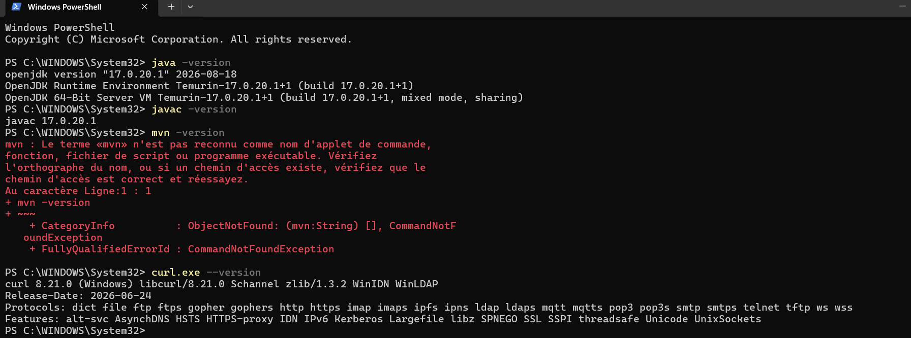
*Capture 01 – Versions des outils installés.*

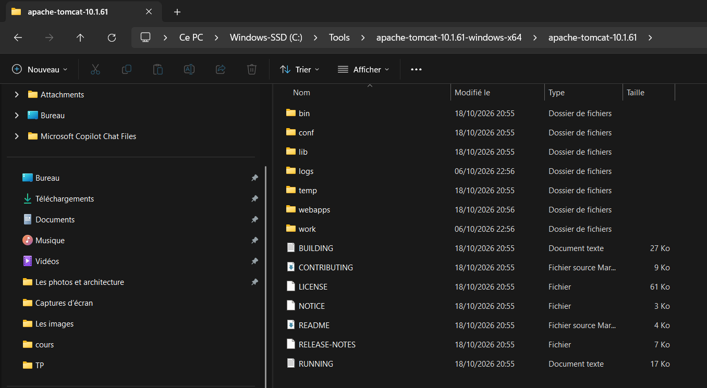
*Capture 02 – Tomcat 10.1.61 installé dans `C:\Tools\...`.*

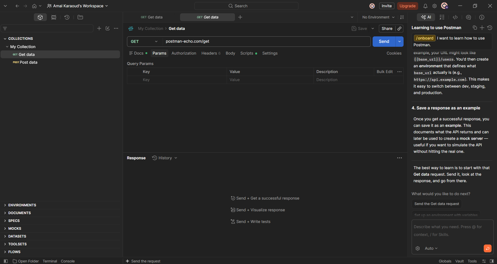
*Capture 03 – Postman installé et ouvert.*

---

<a id="partie-a"></a>
## 3. Partie A – Conception du service

### A.1 Tableau des URI (avec codes de statut : voir [synthèse, question 1](#synthese))

**Famille 1 – calculs directs (rien n'est enregistré)**

| Verbe | URI | Rôle |
|---|---|---|
| GET | `/calcul/somme?a=2&b=3` | a + b |
| GET | `/calcul/soustraction?a=2&b=3` | a − b |
| GET | `/calcul/produit?a=2&b=3` | a × b |
| GET | `/calcul/division?a=6&b=3` | a ÷ b |

**Famille 2 – historique des opérations**

| Verbe | URI | Rôle |
|---|---|---|
| POST | `/operations` | Crée une opération (calcul effectué et enregistré) |
| GET | `/operations` | Retourne toutes les opérations |
| GET | `/operations/{id}` | Retourne l'opération numéro `id` |
| PUT | `/operations/{id}` | Modifie l'opération numéro `id` |
| DELETE | `/operations/{id}` | Supprime l'opération numéro `id` |

### A.2 Questions de conception

**1. Pourquoi les calculs directs utilisent-ils le verbe GET et non POST ?**
Un calcul direct ne modifie rien sur le serveur : il se contente de *lire* un résultat. GET est le verbe prévu pour la lecture ; il est sûr (sans effet de bord) et idempotent, et il permet de tester le service directement depuis la barre d'adresse du navigateur. POST sert à créer une ressource ou à déclencher un traitement qui change l'état du serveur.

**2. Dans `/calcul/somme?a=2&b=3`, comment s'appelle la partie située après le point d'interrogation ?**
C'est la **chaîne de requête** (*query string*) ; ses éléments `a=2` et `b=3` sont des **paramètres de requête** (*query parameters*), de la forme `clé=valeur`, séparés par `&`.

**3. Quelle différence entre `/operations` et `/operations/3` ?**
`/operations` désigne la **collection** de toutes les opérations ; `/operations/3` désigne **une ressource précise** de cette collection : l'opération d'identifiant 3.

**4. Quel code de statut HTTP pour `/operations/99` si cette opération n'existe pas ?**
**404 Not Found**.

---

<a id="partie-b"></a>
## 4. Partie B – Création du projet Maven

### B.1 Création du projet

Générateur **Jakarta EE** d'IntelliJ : nom `TP2-MS`, modèle *REST service*, serveur Tomcat 10.1.61, Maven, groupe `com.exemple`, artefact `RestWebApp`, version **Jakarta EE 10** (Tomcat 10.1 correspond à Jakarta EE 10 ; une version plus récente demanderait un Tomcat plus récent).

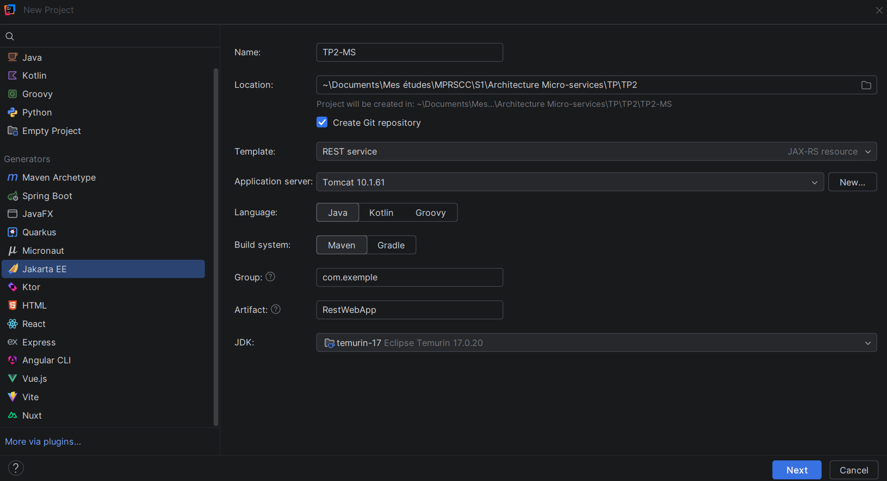
*Capture 04 – Fenêtre New Project, générateur Jakarta EE.*

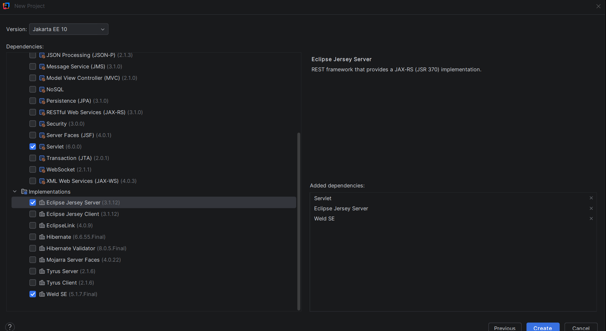
*Capture 05 – Choix de la version Jakarta EE 10.*

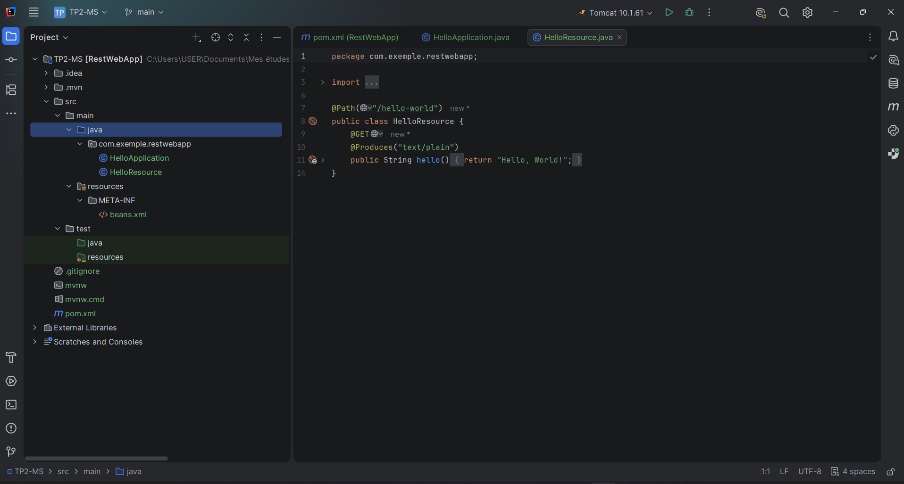
*Capture 06 – Projet créé.*

### B.2 Structure

Le paquetage `com.exemple.rest` contient les six classes demandées (les classes d'exemple générées par le modèle ont été supprimées).

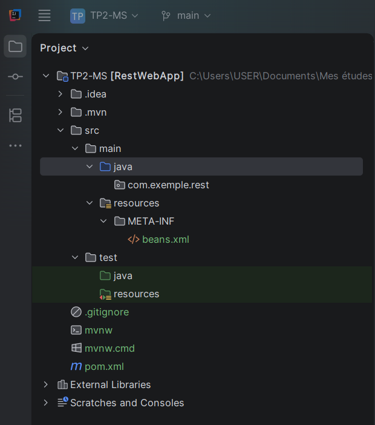
*Capture 07 – Création du paquetage `com.exemple.rest`.*

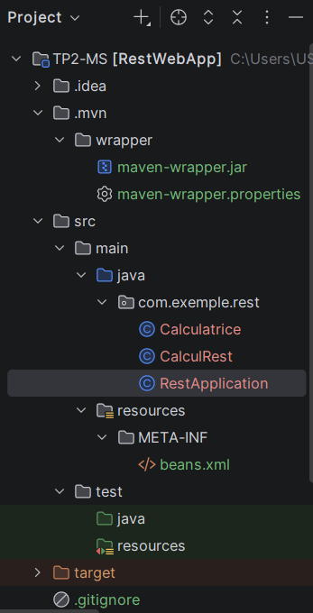
*Capture 13 – Structure des classes après la partie C.*

### B.3 Fichier `pom.xml`

Le `pom.xml` reprend celui de l'énoncé (packaging `war`, Jersey 3.1.9, `finalName` = `RestWebApp`, compilation en Java 17). **Un seul ajout** a été nécessaire, voir [section 12](#limites) : `<failOnMissingWebXml>false</failOnMissingWebXml>` dans le `maven-war-plugin`.

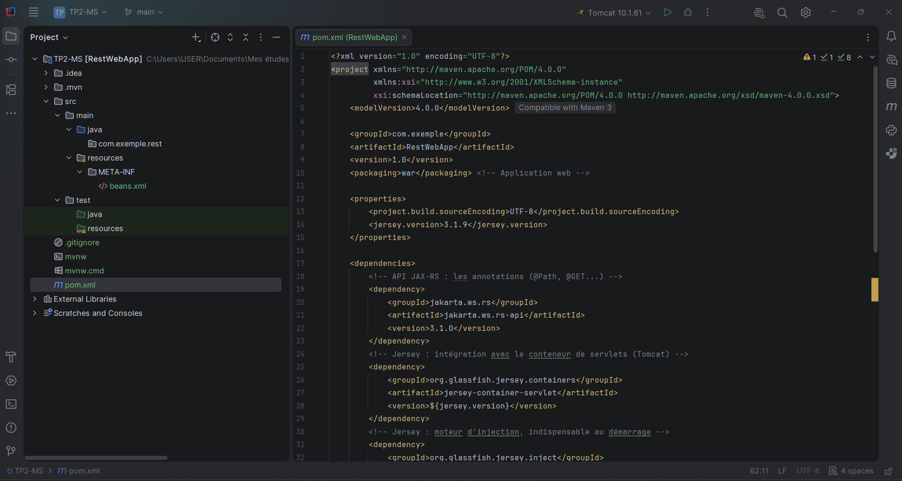
*Capture 08a – `pom.xml`, lignes 1 à 32.*

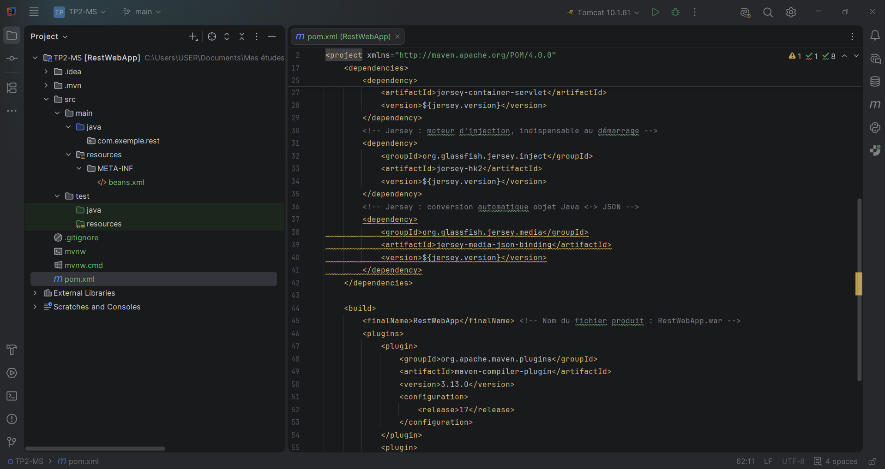
*Capture 08b – `pom.xml`, lignes 25 à 55.*

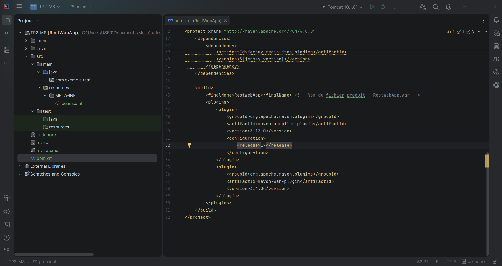
*Capture 08c – `pom.xml`, fin du fichier.*

### B.4 Vérification de la configuration

Rechargement du projet Maven (*Reload All Maven Projects*), puis contrôle de l'onglet *Problems › Project Errors* : aucune erreur.

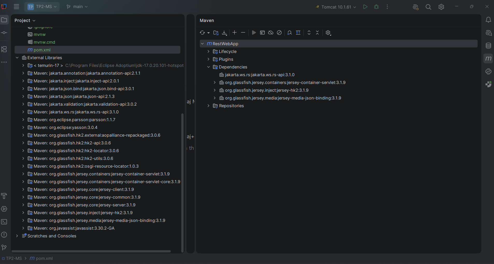
*Capture 09 – Rechargement Maven, dépendances résolues.*

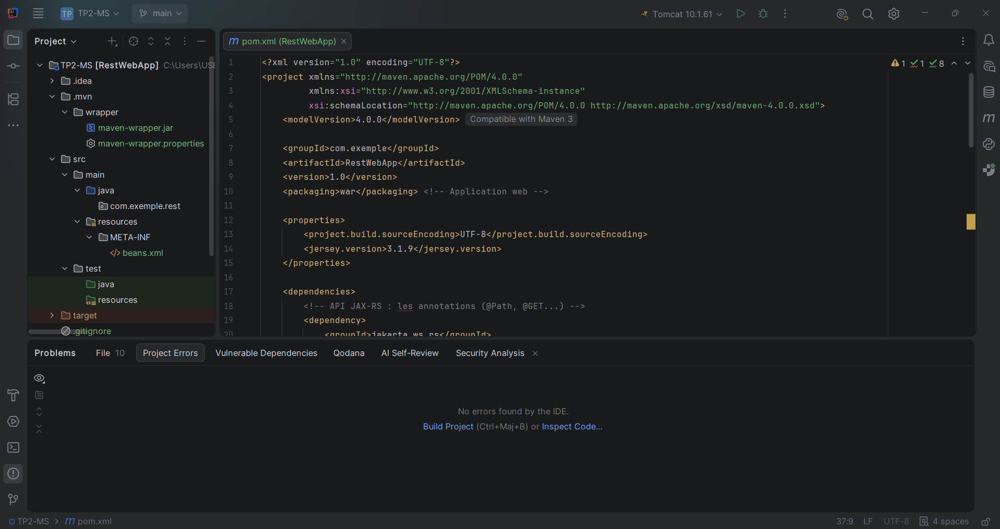
*Capture 09b – Onglet Project Errors.*

---

<a id="partie-c"></a>
## 5. Partie C – Premier service REST : la somme

### C.1 à C.3 Les trois classes

| Classe | Rôle | Fichier |
|---|---|---|
| `Calculatrice` | Logique métier : classe Java ordinaire, ne connaît ni HTTP ni REST | [`Calculatrice.java`](src/main/java/com/exemple/rest/Calculatrice.java) |
| `RestApplication` | `@ApplicationPath("/api")` : active JAX-RS, remplace `web.xml` | [`RestApplication.java`](src/main/java/com/exemple/rest/RestApplication.java) |
| `CalculRest` | Ressource `/calcul` : chaque méthode annotée répond à une requête HTTP | [`CalculRest.java`](src/main/java/com/exemple/rest/CalculRest.java) |

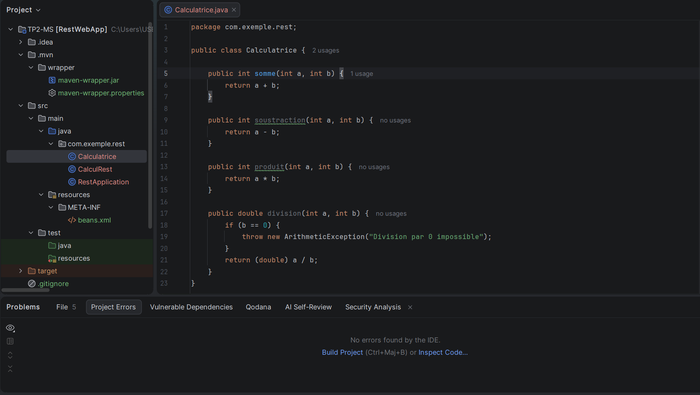
*Capture 10 – Classe `Calculatrice`.*

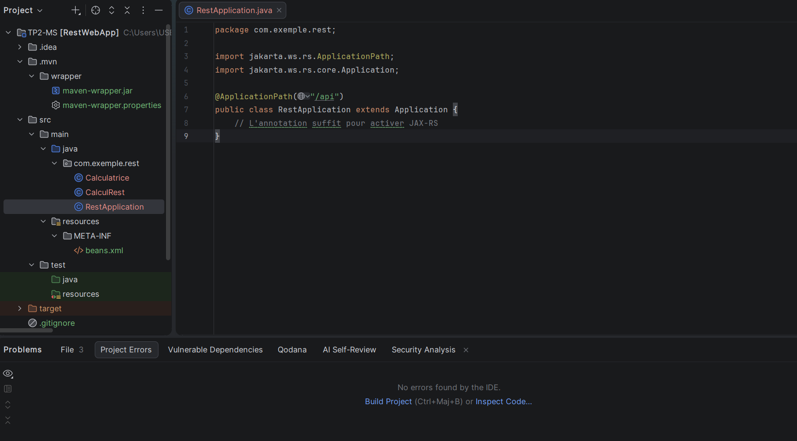
*Capture 11 – Classe `RestApplication`.*

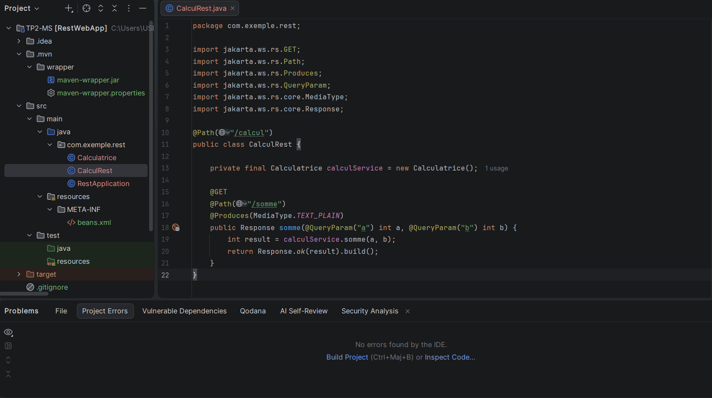
*Capture 12 – Classe `CalculRest` (méthode `somme`).*

Rôle des annotations utilisées dans `CalculRest.somme` :

| Annotation | Rôle |
|---|---|
| `@Path("/calcul")` (classe) | Toutes les méthodes répondent sous `/calcul` |
| `@GET` | La méthode répond au verbe HTTP GET |
| `@Path("/somme")` (méthode) | Complète l'URI : `/calcul/somme` |
| `@Produces(MediaType.TEXT_PLAIN)` | La réponse est du texte brut |
| `@QueryParam("a")` | Lit le paramètre `a` de la chaîne de requête et le convertit en `int` |

`Response.ok(result).build()` construit une réponse de statut **200 OK** dont le corps est le résultat.

### C.4 Construction du fichier `.war`

Phase Maven `clean package` : **BUILD SUCCESS** et production de `target/RestWebApp.war`.

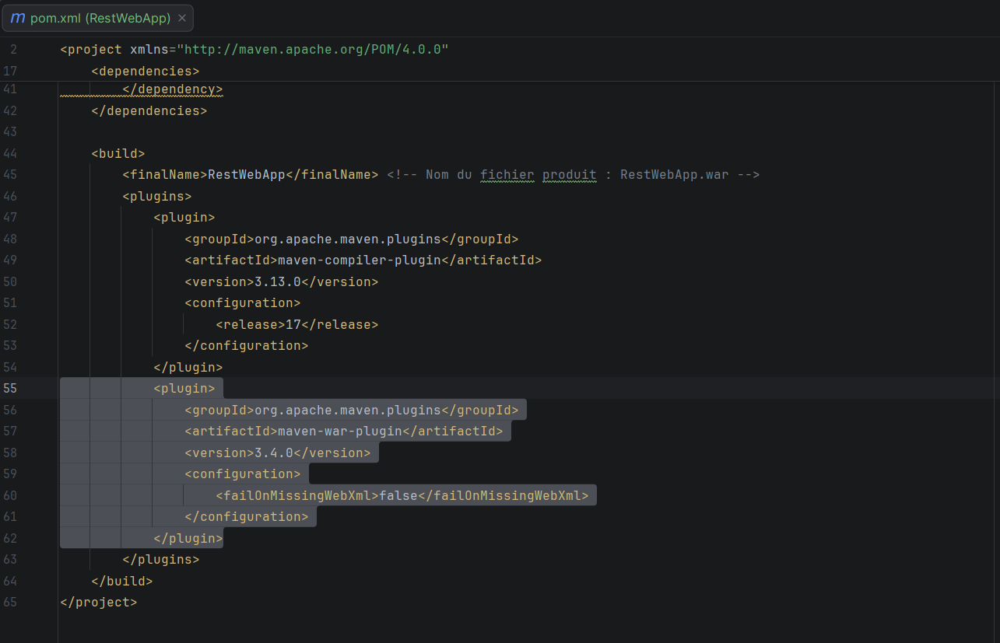
*Capture 14b – `maven-war-plugin` avec `failOnMissingWebXml` à `false`.*

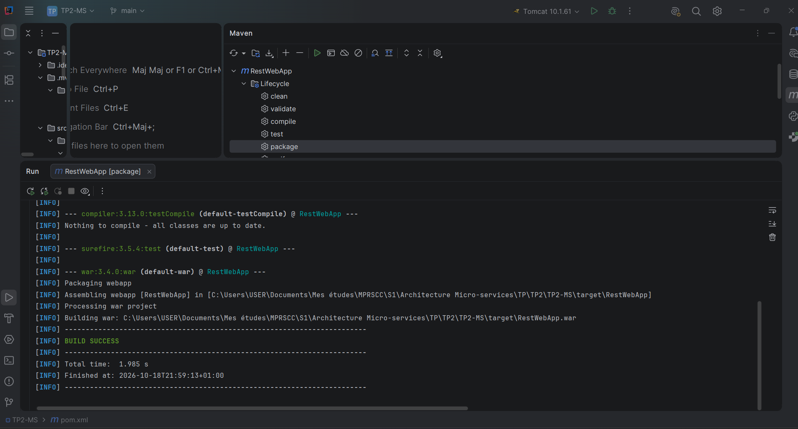
*Capture 14 – `mvn clean package` : BUILD SUCCESS.*

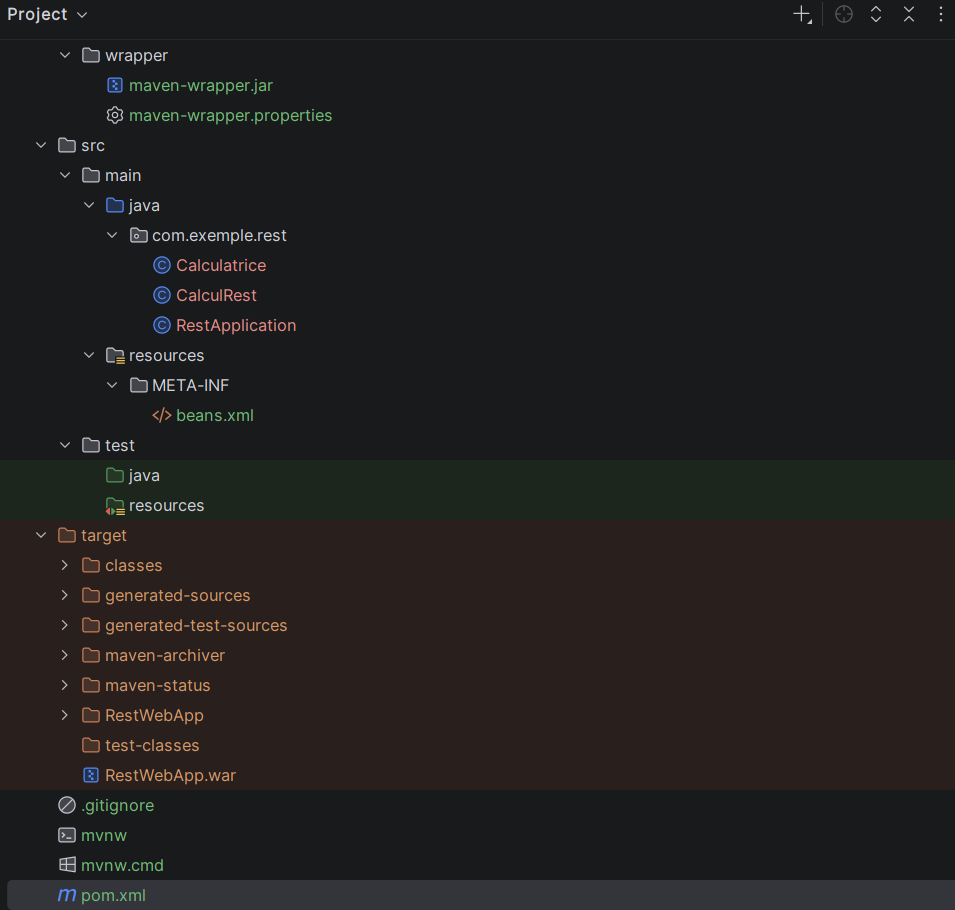
*Capture 15 – `target/RestWebApp.war` produit.*

### C.5 Déploiement dans Tomcat

Configuration d'exécution *Tomcat 10.1.61* : serveur Tomcat 10.1.61, JRE Temurin 17, port HTTP 8080, URL de lancement `http://localhost:8080/RestWebApp/api/calcul/somme?a=2&b=3`, artefact déployé `RestWebApp:war exploded` avec le **contexte d'application `/RestWebApp`** (par défaut IntelliJ propose `/RestWebApp_war_exploded` ; il a été changé pour que les URI correspondent à celles de l'énoncé).

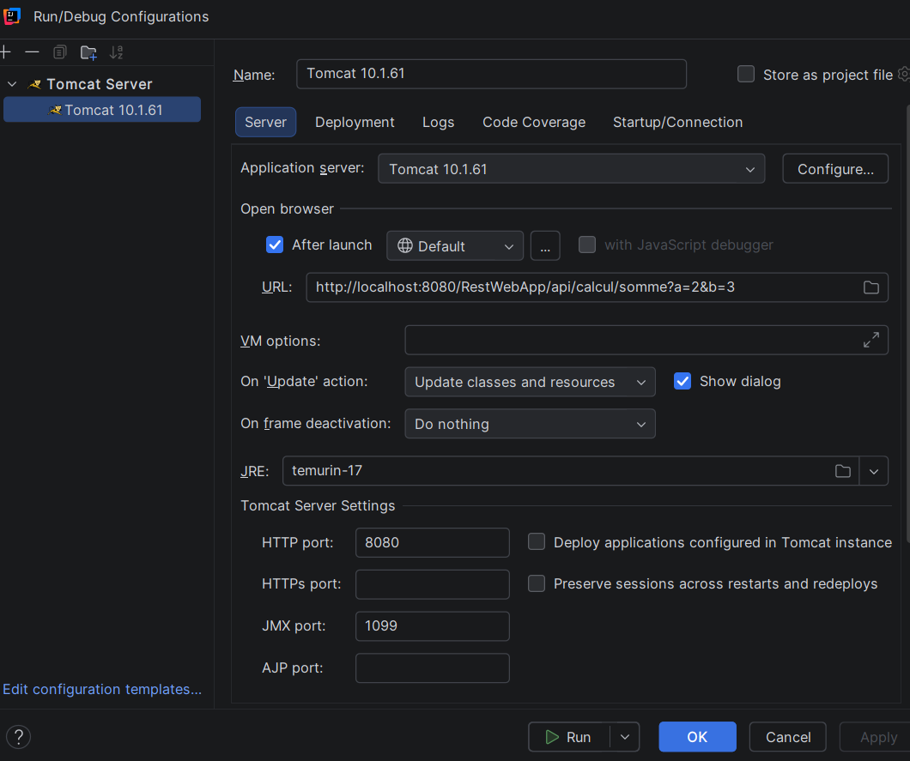
*Capture 16 – Configuration Tomcat, onglet Server.*

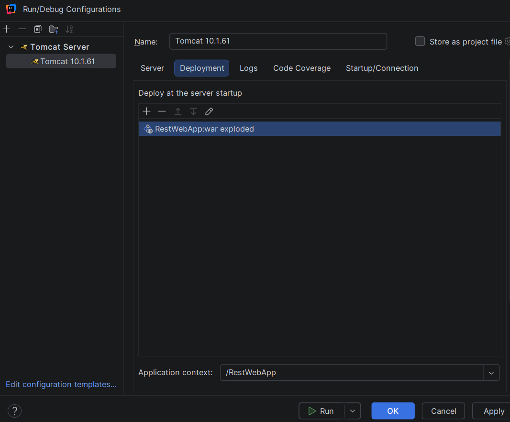
*Capture 17 – Configuration Tomcat, onglet Deployment (contexte `/RestWebApp`).*

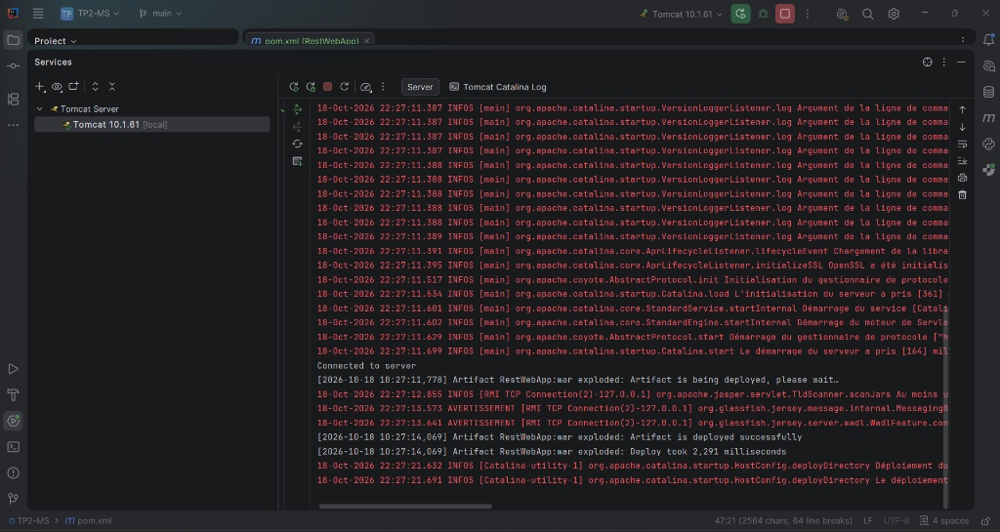
*Capture 18 – Tomcat démarré avec l'application déployée.*

### C.6 Anatomie de l'URL

`http://localhost:8080/RestWebApp/api/calcul/somme?a=2&b=3`

| Partie | Origine |
|---|---|
| `localhost:8080` | Machine locale et port d'écoute de Tomcat |
| `/RestWebApp` | Contexte de l'application (nom du `.war`, balise `<finalName>`) |
| `/api` | `@ApplicationPath("/api")` |
| `/calcul` | `@Path("/calcul")` de la classe |
| `/somme` | `@Path("/somme")` de la méthode |
| `?a=2&b=3` | Paramètres lus par `@QueryParam` |

### C.7 Tests de la somme

| Outil | Requête | Attendu | Obtenu | Capture |
|---|---|---|---|---|
| Navigateur | `GET /calcul/somme?a=2&b=3` | page affichant `5` | TODO | 19 |
| curl | `curl.exe -i "http://localhost:8080/RestWebApp/api/calcul/somme?a=2&b=3"` | `HTTP/1.1 200`, `Content-Type: text/plain`, corps `5` | TODO | 20 |
| Postman | `GET` même URL | `200 OK`, corps `5` | TODO | 21 |
| Postman | `POST` même URL (question C.1) | voir réponse ci-dessous | TODO | 22 |

> Sous PowerShell, `curl` est un alias de `Invoke-WebRequest` ; les commandes de ce compte rendu utilisent donc **`curl.exe`**, le vrai programme curl.

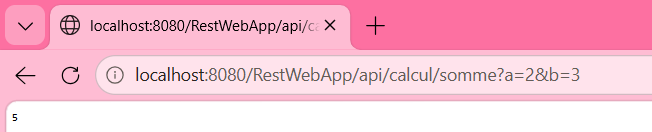
*Capture 19 – Test dans le navigateur.*

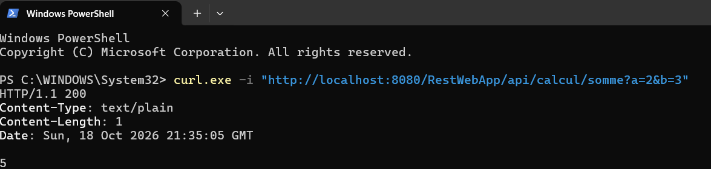
*Capture 20 – Test avec `curl.exe -i`.*

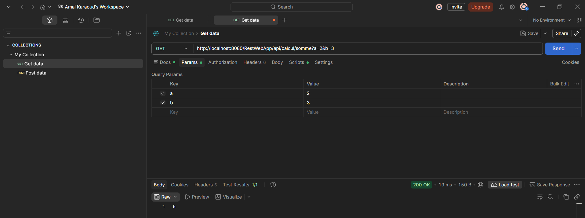
*Capture 21 – Test GET avec Postman.*

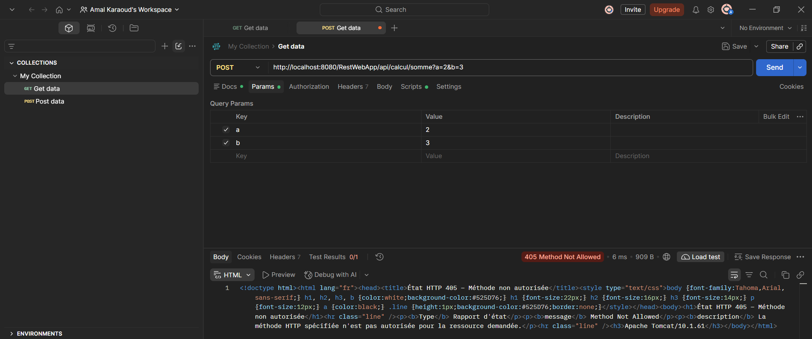
*Capture 22 – Même URL avec le verbe POST.*

**Question C.1. Remplacez GET par POST dans Postman. Quel code de statut obtenez-vous ? Expliquez-le.**
Statut attendu : **405 Method Not Allowed**. L'URI `/calcul/somme` existe, mais la méthode `somme` n'est annotée que par `@GET` : aucune méthode de la ressource ne répond au verbe POST. JAX-RS distingue ce cas du 404 (URI inconnue) : la ressource est trouvée, mais le verbe n'est pas permis.
Statut obtenu : TODO (voir capture 22).

---

<a id="partie-d"></a>
## 6. Partie D – Compléter la calculatrice

### D.1 Soustraction et produit

| Requête | Attendu | Obtenu | Capture |
|---|---|---|---|
| `GET /calcul/soustraction?a=10&b=4` | `6` | TODO | 23 |
| `GET /calcul/produit?a=6&b=7` | `42` | TODO | 24 |

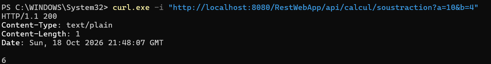
*Capture 23 – `GET /calcul/soustraction?a=10&b=4`.*

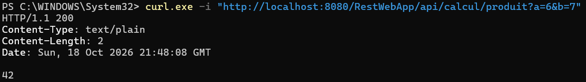
*Capture 24 – `GET /calcul/produit?a=6&b=7`.*

### D.2 Division et gestion d'erreur

Diviser par zéro est une erreur du **client** : le service répond **400 Bad Request** avec un message explicite, plutôt qu'un résultat faux ou une erreur interne (500).

| Requête | Statut attendu | Corps attendu | Obtenu | Capture |
|---|---|---|---|---|
| `GET /calcul/division?a=7&b=2` | 200 | `3.5` | TODO | 25 |
| `GET /calcul/division?a=7&b=0` | 400 | `Erreur : division par 0 impossible` | TODO | 26 |

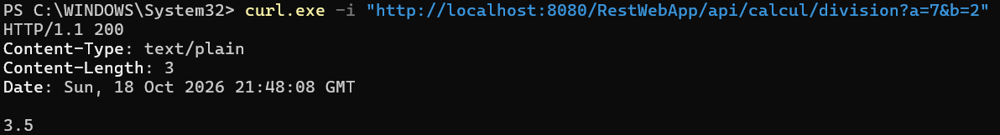
*Capture 25 – Division valide.*

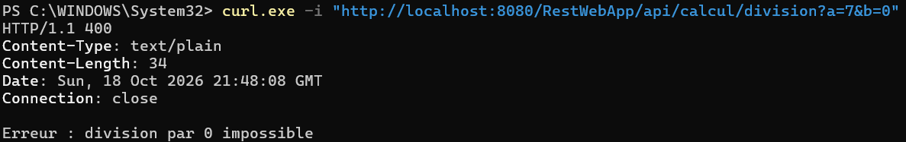
*Capture 26 – Division par zéro : statut 400.*

### D.3 Observations

| Requête | Observation | Capture |
|---|---|---|
| `GET /calcul/somme?a=2` (`b` absent) | TODO (statut et corps) | 27 |
| `GET /calcul/somme?a=abc&b=3` (`a` non entier) | TODO (statut et corps) | 28 |

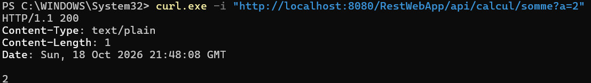
*Capture 27 – Paramètre `b` absent.*

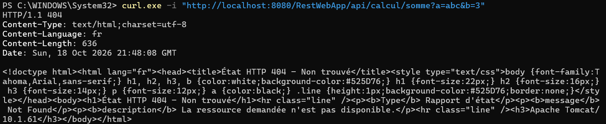
*Capture 28 – Paramètre `a` non entier.*

**Question D.1. Quelle valeur JAX-RS donne-t-il à un paramètre entier absent ?**
Le paramètre est de type primitif `int` : JAX-RS lui affecte la **valeur par défaut du type, soit 0**. Ici `somme?a=2` calcule donc `2 + 0 = 2`.

**Question D.2. Quel statut obtient-on quand le paramètre n'est pas un entier ? La méthode `somme` a-t-elle été exécutée ?**
La spécification JAX-RS prévoit **404 Not Found** lorsqu'un `@QueryParam` ne peut pas être converti dans le type attendu (ici `"abc"` → `int`). La méthode `somme` **n'est pas exécutée** : l'erreur survient avant son appel, pendant la construction de ses arguments par Jersey.
Statut obtenu : TODO (voir capture 28).

### D.4 Paramètres dans le chemin : `@PathParam`

`GET /calcul/produit/6/7` doit retourner `42`.

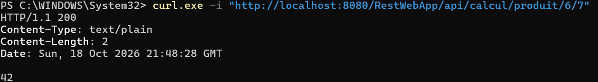
*Capture 29 – `GET /calcul/produit/6/7`.*

**Question D.3. Différence entre `@QueryParam` et `@PathParam` ? Laquelle pour lire l'identifiant dans `/operations/{id}` ?**
`@QueryParam` lit une valeur dans la **chaîne de requête** (après le `?`, forme `?a=2`) : elle sert aux paramètres optionnels, filtres ou options. `@PathParam` lit une valeur dans le **chemin** de l'URI, désignée par un modèle `{nom}` dans `@Path` : elle sert à *identifier* une ressource. Pour `/operations/{id}`, on utilise **`@PathParam("id")`**.

### Classe `CalculRest` complète

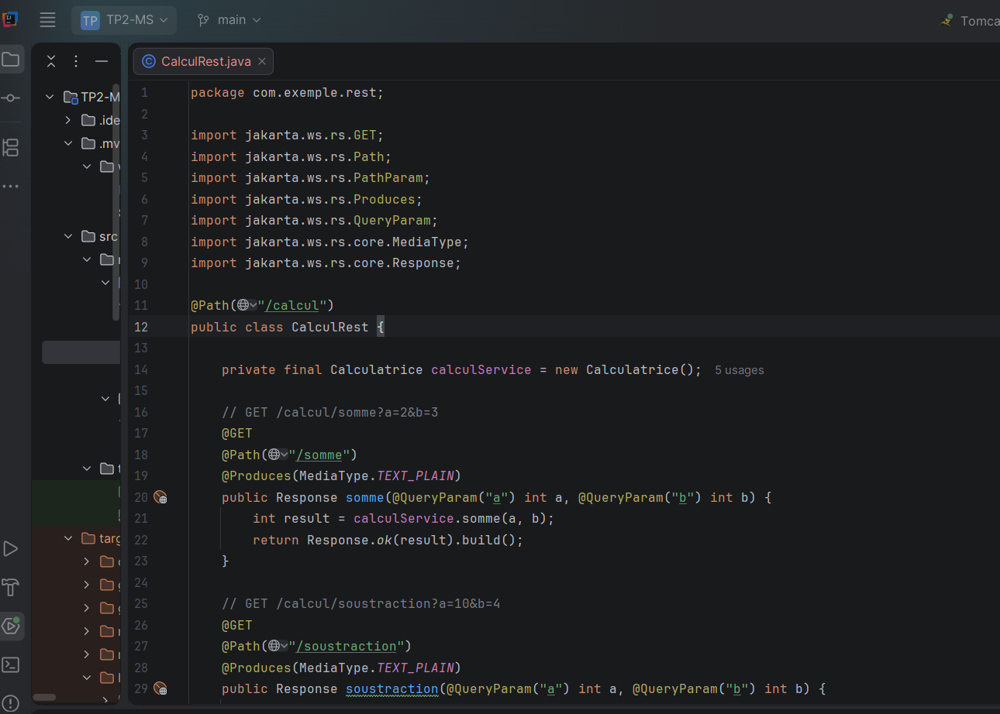
*Capture 30a – `CalculRest`, début.*

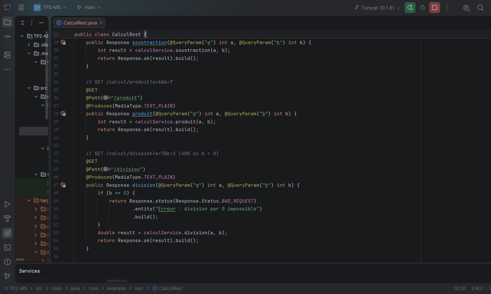
*Capture 30b – `CalculRest`, milieu.*

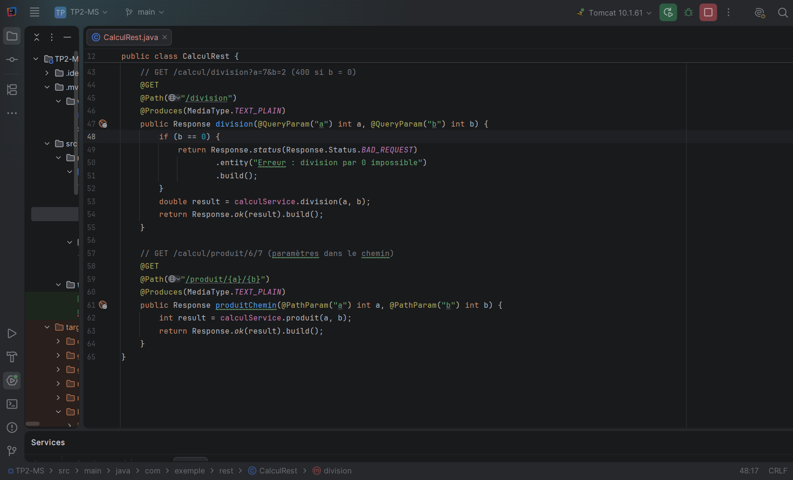
*Capture 30c – `CalculRest`, fin.*

---

<a id="partie-e"></a>
## 7. Partie E – Échanger des données en JSON

### E.1 et E.2 `Resultat` et `GET /calcul/somme/detail`

La classe [`Resultat`](src/main/java/com/exemple/rest/Resultat.java) possède un constructeur public sans argument et des accesseurs `get`/`set`. La méthode `sommeDetail` change uniquement `@Produces` (`application/json`).

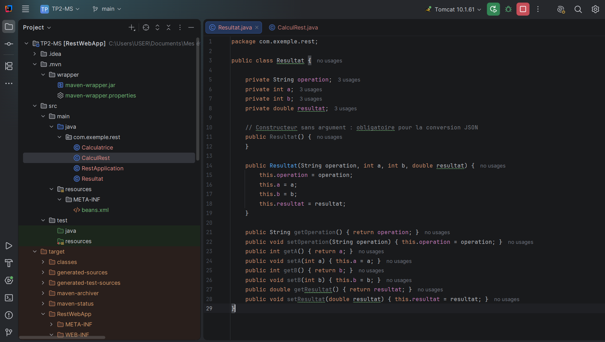
*Capture 31 – Classe `Resultat`.*

| Requête | Attendu | Obtenu | Capture |
|---|---|---|---|
| `curl.exe -i "http://localhost:8080/RestWebApp/api/calcul/somme/detail?a=2&b=3"` | `200`, `Content-Type: application/json`, `{"a":2,"b":3,"operation":"somme","resultat":5.0}` | TODO | 32 |

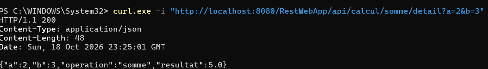
*Capture 32 – `GET /calcul/somme/detail?a=2&b=3`.*

**Question E.1. Aucune ligne de code n'écrit ce JSON. Qui a effectué la conversion ? D'où viennent les noms `a`, `b`, `operation`, `resultat` ?**
La conversion objet Java → JSON est faite automatiquement par **Jersey**, grâce à la dépendance `jersey-media-json-binding` (qui s'appuie sur JSON-B, avec Eclipse Yasson comme implémentation). Les noms des champs JSON proviennent des **accesseurs** de la classe `Resultat` : `getA()` donne `a`, `getB()` donne `b`, `getOperation()` donne `operation`, `getResultat()` donne `resultat` (convention JavaBean : suppression du préfixe `get` et mise en minuscule initiale). C'est pourquoi la classe doit avoir ses `get`/`set` et un constructeur sans argument. L'ordre alphabétique des champs dans le JSON est celui qu'applique JSON-B par défaut.

### E.3 L'en-tête `Accept`

| Requête | Attendu | Obtenu | Capture |
|---|---|---|---|
| `curl.exe -i -H "Accept: application/json" ".../calcul/somme/detail?a=2&b=3"` | 200 | TODO | 33 |
| `curl.exe -i -H "Accept: application/xml" ".../calcul/somme/detail?a=2&b=3"` | 406 | TODO | 34 |

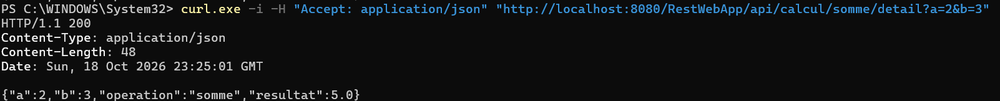
*Capture 33 – `Accept: application/json` : réponse 200.*

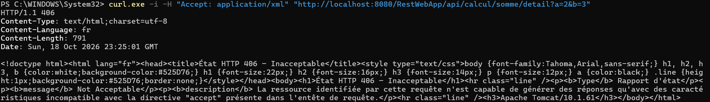
*Capture 34 – `Accept: application/xml` : réponse 406.*

**Question E.2. Pourquoi la seconde requête est-elle refusée ?**
Le client déclare par `Accept: application/xml` qu'il ne sait lire que du XML, alors que la méthode `sommeDetail` n'est annotée que par `@Produces(MediaType.APPLICATION_JSON)` : le service **ne peut produire aucun format acceptable pour le client**. JAX-RS répond donc **406 Not Acceptable** (négociation de contenu).

### E.4 Exercice : `GET /calcul/division/detail`

La méthode `divisionDetail` renvoie un objet `Resultat` en JSON ; si `b` vaut 0, elle répond 400.

| Requête | Attendu | Obtenu | Capture |
|---|---|---|---|
| `GET /calcul/division/detail?a=7&b=2` | 200, JSON de résultat `3.5` | TODO | 35 |
| `GET /calcul/division/detail?a=7&b=0` | 400 | TODO | 36 |

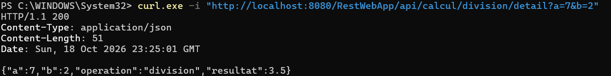
*Capture 35 – `division/detail` valide.*

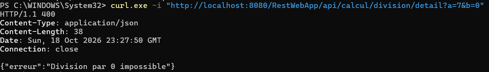
*Capture 36 – `division/detail` avec `b = 0` : 400.*

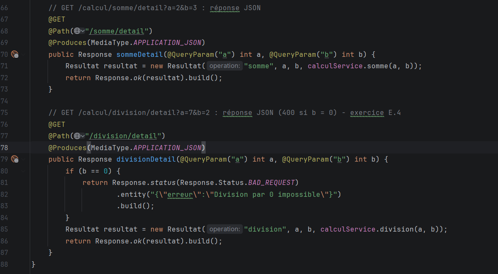
*Capture 36b – `CalculRest` à l'issue de la partie E.*

---

<a id="partie-f"></a>
## 8. Partie F – La ressource « operations » : POST, GET, PUT, DELETE

Les opérations sont conservées **en mémoire** (`ConcurrentHashMap` + `AtomicInteger`, attributs `static`), sans base de données : elles sont perdues à chaque redémarrage de Tomcat ou redéploiement, et la numérotation repart de 1.

### F.1 et F.2 Classes `Operation` et `OperationRest`

Fichiers : [`Operation.java`](src/main/java/com/exemple/rest/Operation.java), [`OperationRest.java`](src/main/java/com/exemple/rest/OperationRest.java).

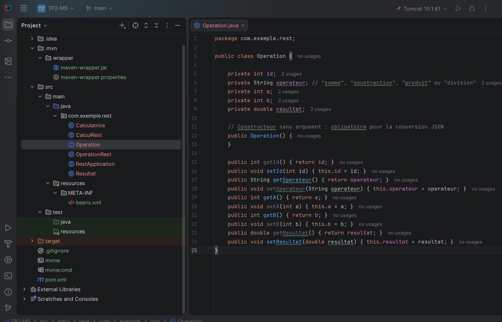
*Capture 37 – Classe `Operation`.*

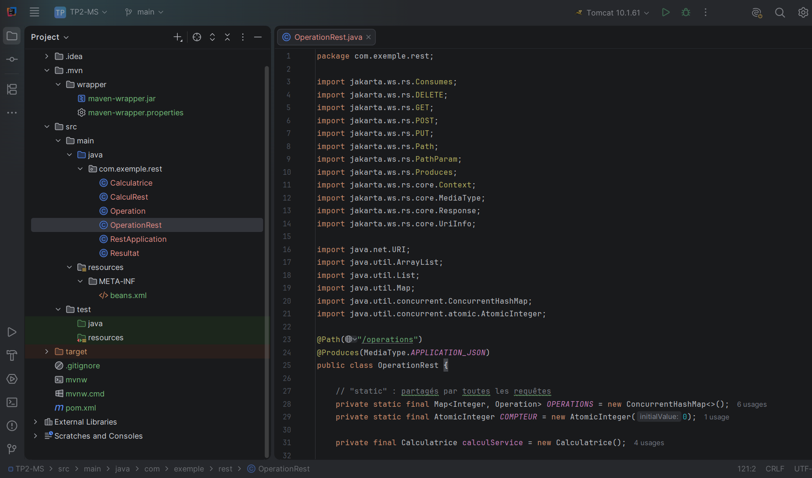
*Capture 38 – `OperationRest`, début (partie 1).*

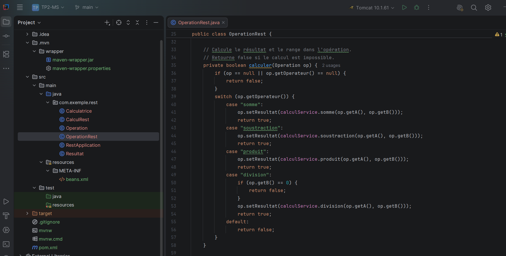
*Capture 38 – `OperationRest`, début (partie 2).*

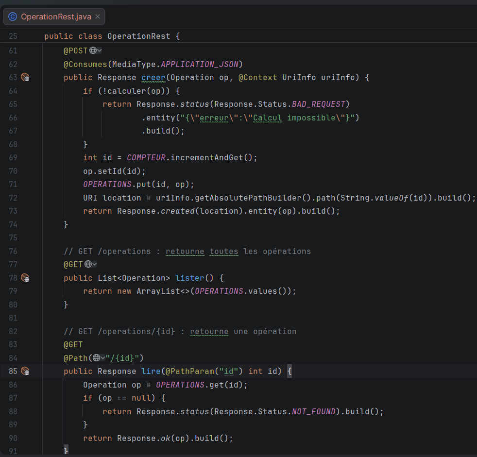
*Capture 38b – `OperationRest` : création et lectures.*

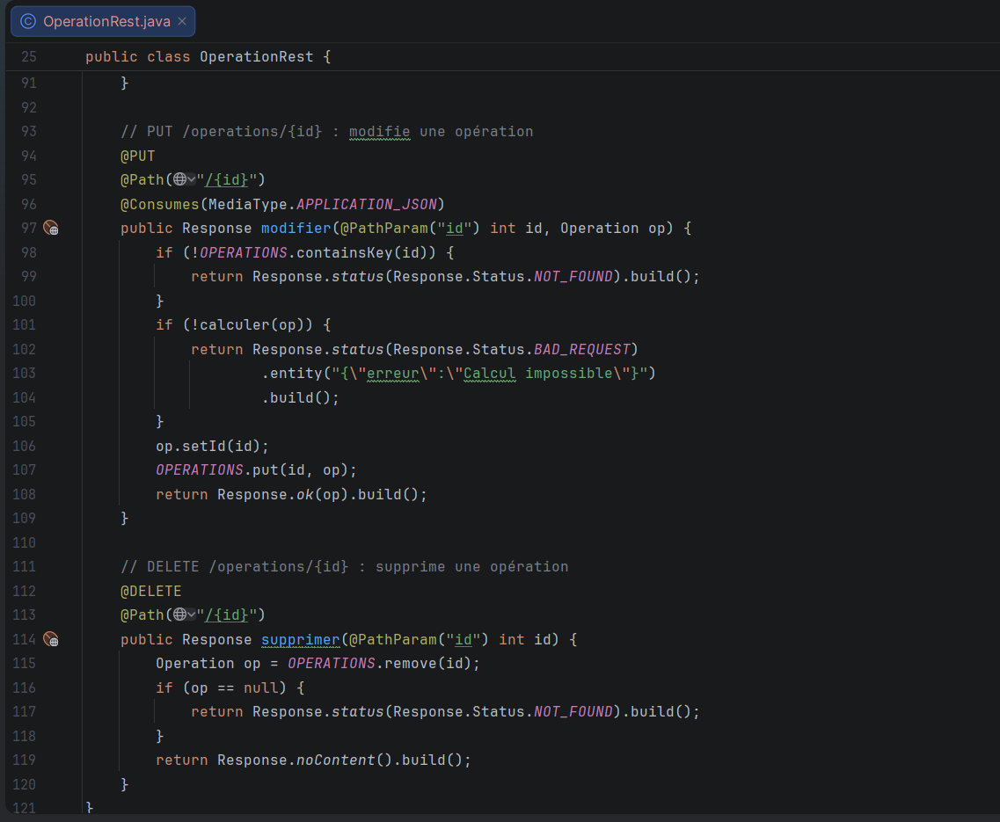
*Capture 38c – `OperationRest` : méthodes `modifier` (PUT) et `supprimer` (DELETE).*

Pourquoi `static` ? Par défaut, JAX-RS crée un nouvel objet `OperationRest` **pour chaque requête** : un attribut ordinaire serait vide à chaque fois. Un attribut `static` appartient à la classe et est partagé par toutes les requêtes ; comme plusieurs requêtes peuvent arriver simultanément, on utilise des structures prévues pour les accès concurrents.

### F.3 Création et lecture : série de 7 tests, dans l'ordre

Les 7 tests ont été exécutés **dans l'ordre, sans redémarrer Tomcat**. Toutes les URI sont préfixées par `http://localhost:8080/RestWebApp/api`.

| N° | Requête | Corps envoyé | Statut attendu | Statut obtenu | Corps obtenu | Capture |
|---|---|---|---|---|---|---|
| 1 | `POST /operations` | `{"operateur":"somme","a":8,"b":2}` | 201 + en-tête `Location` finissant par `/operations/1` | **201**, `Location: http://localhost:8080/RestWebApp/api/operations/1` | `{"a":8,"b":2,"id":1,"operateur":"somme","resultat":10.0}` | 39, 39b |
| 2 | `POST /operations` | `{"operateur":"division","a":7,"b":2}` | 201, opération n° 2, résultat `3.5` | TODO | TODO | 40 |
| 3 | `GET /operations` | – | 200, tableau des deux opérations | TODO | TODO | 41 |
| 4 | `GET /operations/2` | – | 200, opération n° 2 | TODO | TODO | 42 |
| 5 | `GET /operations/99` | – | 404, corps vide | TODO | TODO | 43 |
| 6 | `POST /operations` | `{"operateur":"division","a":7,"b":0}` | 400 `{"erreur":"Calcul impossible"}` | TODO | TODO | 44 |
| 7 | `POST /operations` | `{"operateur":"racine","a":9,"b":0}` | 400 `{"erreur":"Calcul impossible"}` | TODO | TODO | 45 |

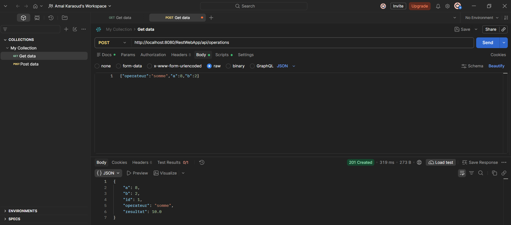
*Capture 39 – Test 1 : `POST /operations` avec Postman.*

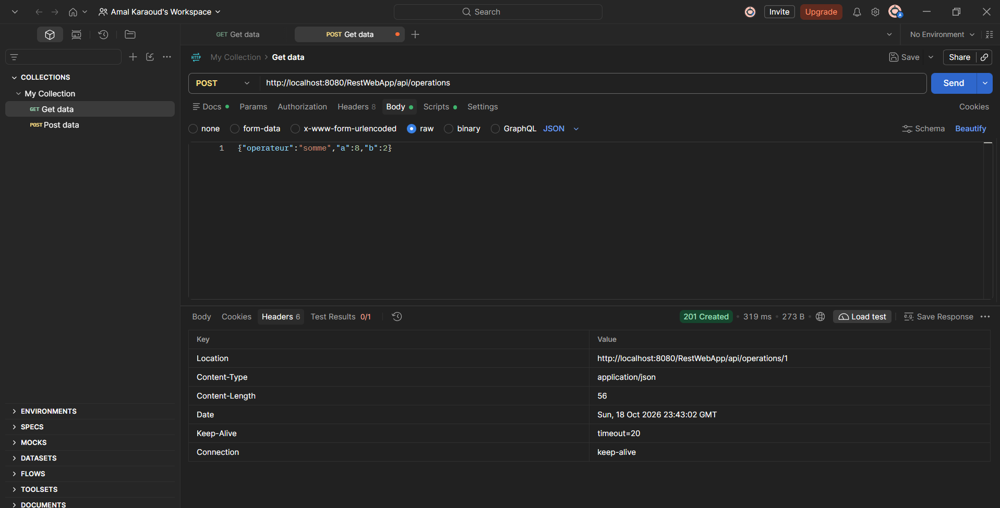
*Capture 39b – Test 1 avec `curl.exe -i` : statut 201 et en-tête `Location`.*


*Capture 40 – Test 2 : `POST /operations` (division 7 / 2).*


*Capture 41 – Test 3 : `GET /operations`.*


*Capture 42 – Test 4 : `GET /operations/2`.*


*Capture 43 – Test 5 : `GET /operations/99` (inexistante).*


*Capture 44 – Test 6 : `POST /operations` avec division par 0.*


*Capture 45 – Test 7 : `POST /operations` avec un opérateur inconnu.*

> **Remarque PowerShell.** Dans PowerShell, la syntaxe `-d "{\"operateur\":...}"` donnée pour `cmd` est mal interprétée (erreur curl `unmatched close brace/bracket`). Le corps JSON a donc été placé dans un fichier temporaire `op.json` (`Set-Content -Path op.json -Value '{"operateur":"somme","a":8,"b":2}' -Encoding ascii`), envoyé avec `--data-binary "@op.json"`. Ce fichier n'appartient pas au dépôt.

### F.4 Modifier une opération : `PUT /operations/{id}`

| Situation | Statut attendu | Corps attendu |
|---|---|---|
| Aucune opération ne porte cet identifiant | 404 | vide |
| Calcul impossible (opérateur inconnu, division par 0) | 400 | `{"erreur":"Calcul impossible"}` |
| Modification réussie | 200 | opération modifiée (même `id`, nouveau `resultat`) |

| Test | Requête | Statut obtenu | Corps obtenu | Capture |
|---|---|---|---|---|
| Modification réussie | `PUT /operations/1` avec `{"operateur":"produit","a":8,"b":2}` | **200 OK** | `{"a":8,"b":2,"id":1,"operateur":"produit","resultat":16.0}` | 46 |
| Vérification | `GET /operations/1` | **200 OK** | `{"a":8,"b":2,"id":1,"operateur":"produit","resultat":16.0}` | 47 |
| Identifiant inexistant | `PUT /operations/99` | **404** | page d'erreur HTML de Tomcat (voir remarque) | 48 |
| Calcul impossible | `PUT /operations/1` avec `{"operateur":"racine","a":1,"b":1}` | **400 Bad Request** | `{"erreur":"Calcul impossible"}` | 49 |


*Capture 46 – `PUT /operations/1` : 200 et résultat `16.0`.*


*Capture 47 – `GET /operations/1` après modification : l'opération a bien été remplacée.*


*Capture 48 – `PUT /operations/99` avec `curl.exe -i` : statut 404.*


*Capture 49 – `PUT /operations/1` avec un opérateur inconnu : 400.*

> **Remarque sur le 404 « à corps vide ».** La méthode renvoie bien un 404 sans corps. Pour les statuts d'erreur sans corps, Jersey délègue au conteneur, et Tomcat génère alors sa page d'erreur HTML par défaut (`Content-Type: text/html;charset=utf-8`, visible sur la capture 48). Le **statut 404**, qui est la donnée significative du test, est conforme ; le corps vide est celui produit par l'application, avant l'intervention de Tomcat.

### F.5 Supprimer une opération : `DELETE /operations/{id}`

| Étape | Requête | Statut attendu | Statut obtenu |
|---|---|---|---|
| 1 | `curl.exe -i -X DELETE ".../operations/1"` | 204 | TODO |
| 2 | `curl.exe -i ".../operations/1"` | 404 | TODO |
| 3 | `curl.exe -i -X DELETE ".../operations/1"` | 404 | TODO |


*Capture 50 – Séquence DELETE, GET, DELETE : 204, 404, 404.*

---

<a id="synthese"></a>
## 9. Questions de synthèse

**1. Tableau de l'étape A.1 avec les codes de statut que le service peut renvoyer**

| Verbe | URI | Rôle | Codes de statut possibles |
|---|---|---|---|
| GET | `/calcul/somme?a=..&b=..` | a + b | 200 ; 404 (paramètre non entier) |
| GET | `/calcul/soustraction?a=..&b=..` | a − b | 200 ; 404 (paramètre non entier) |
| GET | `/calcul/produit?a=..&b=..` | a × b | 200 ; 404 (paramètre non entier) |
| GET | `/calcul/division?a=..&b=..` | a ÷ b | 200 ; 400 (b = 0) ; 404 (paramètre non entier) |
| POST | `/operations` | Crée une opération | 201 (créée) ; 400 (calcul impossible) ; 415 (corps non JSON) |
| GET | `/operations` | Liste des opérations | 200 ; 406 (Accept incompatible) |
| GET | `/operations/{id}` | Une opération | 200 ; 404 (id inconnu) |
| PUT | `/operations/{id}` | Modifie une opération | 200 ; 400 (calcul impossible) ; 404 (id inconnu) ; 415 |
| DELETE | `/operations/{id}` | Supprime une opération | 204 (supprimée) ; 404 (id inconnu) |

Tout verbe non prévu sur une URI existante (par exemple POST sur `/calcul/somme`) donne **405 Method Not Allowed**. Les codes réellement obtenus lors des tests sont consignés dans les tableaux « Obtenu » des parties C à F. Le code 415 est celui que JAX-RS prévoit lorsque le `Content-Type` envoyé ne correspond pas à `@Consumes` ; il n'a pas été testé dans ce TP.

**2. Annotations JAX-RS utilisées et rôle de chacune**

| Annotation | Rôle |
|---|---|
| `@ApplicationPath("/api")` | Active JAX-RS et fixe le préfixe de toutes les URI du service. |
| `@Path` | Associe une classe ou une méthode à une partie de l'URI (`{id}` pour un paramètre de chemin). |
| `@GET`, `@POST`, `@PUT`, `@DELETE` | Lient la méthode au verbe HTTP correspondant. |
| `@Produces` | Indique le type de contenu renvoyé (`text/plain`, `application/json`) et sert à la négociation avec `Accept`. |
| `@Consumes` | Indique le type de contenu accepté en entrée (JSON pour POST et PUT). |
| `@QueryParam` | Lit un paramètre de la chaîne de requête (`?a=2`). |
| `@PathParam` | Lit une valeur située dans le chemin de l'URI (`/operations/{id}`). |
| `@Context` | Demande l'injection d'un objet du contexte, ici `UriInfo` pour construire l'URI de l'en-tête `Location`. |

**3. Différence entre JAX-RS et Jersey**
**JAX-RS** (Jakarta RESTful Web Services) est une **spécification** : elle définit l'API (les annotations et classes du paquetage `jakarta.ws.rs`, dépendance `jakarta.ws.rs-api`) mais ne fait rien toute seule. **Jersey** est une **implémentation** de cette spécification (c'est l'implémentation de référence) : il fournit le moteur qui lit les annotations, fait correspondre les requêtes HTTP aux méthodes, convertit les paramètres et le JSON (dépendances `org.glassfish.jersey.*`). On code contre l'API JAX-RS, et Jersey l'exécute.

**4. Rôle de Tomcat ; pourquoi un `.war` et non un `.jar` exécutable ?**
Tomcat est un **conteneur de servlets** (serveur d'applications web) : il écoute les requêtes HTTP, gère les connexions et le cycle de vie des applications, et transmet les requêtes à Jersey, qui s'exécute comme une servlet à l'intérieur. Notre application ne contient ni serveur HTTP ni méthode `main` : elle est un **module web** destiné à être **déployé dans** un conteneur existant. Le format adapté est donc le **`.war`** (*Web Application Archive*), que Tomcat sait déployer. Un `.jar` exécutable embarquerait son propre serveur et se lancerait seul ; ce n'est pas l'architecture de ce TP.

**5. *Stateless* et conservation de la liste des opérations**
Le principe *stateless* signifie que le serveur ne mémorise pas **d'état de conversation propre à un client** entre deux requêtes : chaque requête contient tout ce qu'il faut pour être traitée, sans dépendre d'une requête précédente ni d'une session. La liste des opérations n'est pas un état de client mais **l'état de la ressource**, c'est-à-dire des *données* de l'application, partagées par tous les clients, au même titre que le contenu d'une base de données. Une requête `GET /operations/2` fonctionne de la même façon quel que soit le client et quelles que soient ses requêtes précédentes. (Limite pratique : ces données étant en mémoire, elles ne survivent pas à un redémarrage ; en production on les placerait dans une base de données.)

**6. Répétition de `POST /operations` et de `PUT /operations/1`**
- **POST répété deux fois** : chaque envoi **crée une nouvelle opération** (identifiants 1 puis 2, deux entrées dans la liste). POST n'est **pas idempotent** : répéter la requête change à chaque fois l'état du serveur.
- **PUT répété deux fois** : la seconde requête remplace l'opération n° 1 par un contenu identique ; l'état final est **le même qu'après la première**, aucune opération n'est créée. PUT est **idempotent**.

---

<a id="structure"></a>
## 10. Structure du dépôt

```text
TP2-MS/
├── README.md                          ← ce compte rendu
├── pom.xml                            ← projet Maven (packaging war)
├── mvnw, mvnw.cmd, .mvn/              ← wrapper Maven
├── .gitignore                         ← exclut target/ et .idea/
├── captures/                          ← captures d'écran citées dans le README
└── src/main/
    ├── java/com/exemple/rest/
    │   ├── Calculatrice.java          ← logique métier
    │   ├── RestApplication.java       ← @ApplicationPath("/api")
    │   ├── CalculRest.java            ← ressource /calcul
    │   ├── Resultat.java              ← objet JSON de la partie E
    │   ├── Operation.java             ← objet de l'historique
    │   └── OperationRest.java         ← ressource /operations
    └── resources/META-INF/beans.xml   ← fichier généré par le modèle IntelliJ
```

---

<a id="execution"></a>
## 11. Construire et exécuter le projet

Prérequis : JDK 17 (variable `JAVA_HOME` définie) et Apache Tomcat 10.1.x.

```powershell
# À la racine du dépôt
.\mvnw.cmd clean package
```

Résultat attendu : `BUILD SUCCESS` et le fichier `target\RestWebApp.war`.

**Déploiement** (méthode utilisée dans ce TP) : configuration d'exécution Tomcat d'IntelliJ avec l'artefact `RestWebApp:war exploded` et le contexte d'application `/RestWebApp` (captures 16 et 17).
Alternative standard, non utilisée dans ce TP : copier `target\RestWebApp.war` dans le dossier `webapps` de Tomcat et démarrer Tomcat ; le contexte est alors le nom du fichier, `/RestWebApp`.

Test rapide : ouvrir `http://localhost:8080/RestWebApp/api/calcul/somme?a=2&b=3` ; la page doit afficher `5`.

---

<a id="limites"></a>
## 12. Écarts avec l'énoncé et limites

**Écarts de configuration**

| Point | Énoncé | Réalisé | Justification |
|---|---|---|---|
| `maven-war-plugin` | version 3.4.0 seule | version 3.4.0 + `<failOnMissingWebXml>false</failOnMissingWebXml>` | Le projet n'a pas de `web.xml` (remplacé par `@ApplicationPath`, comme l'énoncé le demande) ; sans cette option, le packaging `war` échoue avec « webxml attribute is required ». |
| Contexte d'application | `/RestWebApp_war_exploded` par défaut | `/RestWebApp` | Pour que les URL de test de l'énoncé (`/RestWebApp/api/...`) fonctionnent. |
| JRE de la configuration Tomcat | exemple : JDK 27 | Temurin 17 | Cohérent avec `release 17` du `pom.xml`. |

**Limites du service**
- Les opérations sont stockées en mémoire : perdues au redémarrage de Tomcat ou au redéploiement.
- Aucun test automatisé : la vérification a été faite manuellement (navigateur, `curl.exe`, Postman), comme l'énoncé le demande.
- `GET /operations` ne garantit pas l'ordre des opérations (`ConcurrentHashMap` n'est pas ordonnée).
- Les statuts d'erreur sans corps (404 notamment) s'accompagnent de la page d'erreur HTML de Tomcat ; une API de production renverrait un corps JSON d'erreur homogène.
